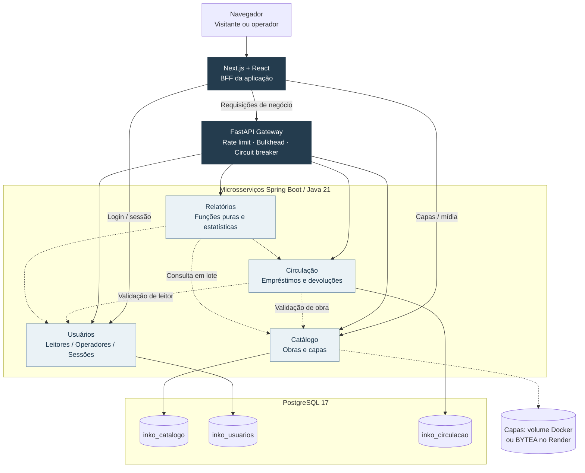
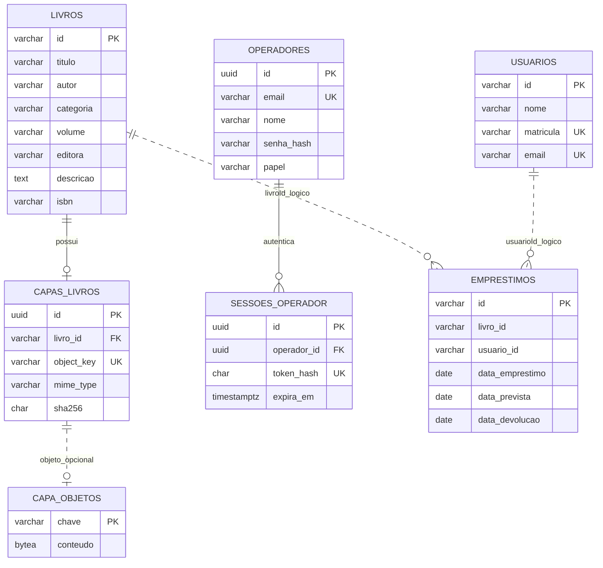
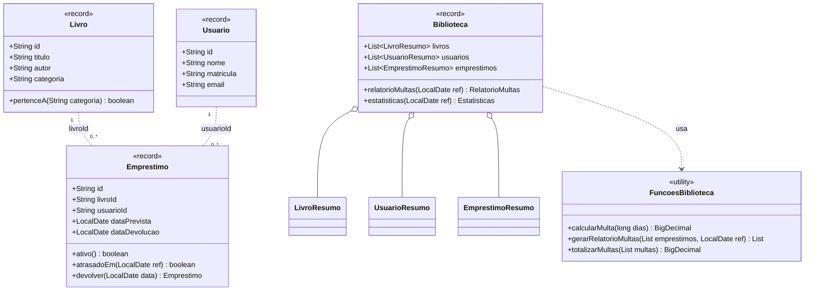
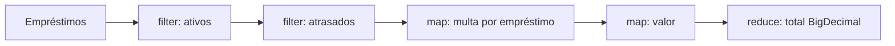

<div align="center">


# INKO — Uma estante. Infinitos universos.

### Grandes histórias merecem uma estante à altura.

**Sistema de Biblioteca de Mangás, HQs e Graphic Novels**

**Projeto acadêmico de Paradigmas de Linguagens de Programação · Java 21 · 2026**

[](https://inko-piloto-web.onrender.com/landing)
[](https://github.com/DevAngeloOliveira/Inko/releases/tag/v0.5.0)
[](https://github.com/DevAngeloOliveira/Inko)

**[Landing pública](https://inko-piloto-web.onrender.com/landing)** · **[Catálogo](https://inko-piloto-web.onrender.com/)** · **[Área de operadores](https://inko-piloto-web.onrender.com/login)** · **[Releases](https://github.com/DevAngeloOliveira/Inko/releases)**

</div>

---

> **Apresentação do projeto:** o INKO gerencia livros, leitores, empréstimos, devoluções, disponibilidade e multas em uma biblioteca de mangás e quadrinhos. O núcleo foi desenvolvido em Java para demonstrar **orientação a objetos, funções puras, imutabilidade e §map§ / §filter§ / §reduce§**, como exigido na disciplina. A aplicação foi ampliada para um MVP web com microsserviços e persistência, embora banco de dados **não fosse obrigatório** no exercício.

## Apresentação acadêmica — o que o professor solicitou

| Requisito | Como o INKO demonstra | Referência |
| --- | --- | --- |
| **POO** | §Livro§, §Usuario§, §Emprestimo§, §Biblioteca§ e interfaces de repositório | [UML](#diagrama-uml-de-classes) |
| **Funções puras** | §calcularMulta§ e transformações determinísticas de coleções | [Java](#funções-puras-e-regra-da-multa) |
| **Imutabilidade** | Java §record§; §Emprestimo.devolver§ retorna novo valor; §List.copyOf§ | [Código](#imutabilidade-e-orientação-a-objetos) |
| **map, filter, reduce** | Pipeline de relatório de multas com Java Streams | [Código](#pipeline-funcional-filter--map--reduce) |
| **Empréstimos** | Cadastro de empréstimo com livro, usuário e prazo | [Circulação](#regras-de-empréstimo-devolução-e-disponibilidade) |
| **Devoluções** | Devolução que encerra empréstimo e preserva histórico | [Circulação](#regras-de-empréstimo-devolução-e-disponibilidade) |
| **Disponibilidade** | Um empréstimo ativo por livro, protegido pelo banco | [SQL](#regras-de-empréstimo-devolução-e-disponibilidade) |
| **Multa** | **R$ 2,00 por dia de atraso**, com §BigDecimal§ | [Java](#funções-puras-e-regra-da-multa) |
| **GitHub, README e testes** | Monorepo público, JUnit, pytest, testes web e E2E | [Testes](#testes) |
| **Código sem comentários** | Núcleo de domínio Java escrito sem comentários de implementação | [FuncoesBiblioteca](services/relatorios/src/main/java/br/com/inko/relatorios/biblioteca/FuncoesBiblioteca.java) |

### Regras da entrega

| Modalidade | Nota | Material solicitado |
| --- | --- | --- |
| **Coletiva** | **3,0 pontos** | Projeto no GitHub, README e testes |
| **Individual (incluída na entrega de 3,0 pontos)** | — | Dois diagramas e respostas a cinco questões **escritos à mão** |
| **Apresentação** | **2,0 pontos** | Cada integrante responde individualmente a uma pergunta sobre o código |

> **Entrega física obrigatória:** os **dois diagramas e as cinco respostas manuscritas em papel A4 branco** devem ser entregues **presencialmente ao professor em sala de aula**. Os Mermaid abaixo são modelos para estudo e transcrição: **não substituem os desenhos feitos à mão**. Consulte [material de estudo](docs/academic/PRESENTATION-QA.md); confira as cinco perguntas exatas fornecidas pelo professor antes de redigir as respostas.

### Piloto online e acervo

**[Acessar o piloto publicado no Render](https://inko-piloto-web.onrender.com/landing)** — experiência editorial de descoberta de mangás, HQs e graphic novels, com uma área privada para operações dos bibliotecários.

A carga prevista nas migrations do piloto contempla **505 edições**, **36 leitores fictícios** e **60 empréstimos demonstrativos**. São dados de demonstração preparados para a apresentação, e **não** clientes, usuários comerciais ou métricas de audiência. Instâncias Render gratuitas podem apresentar atraso na primeira abertura. [Detalhes do piloto](docs/devops/PILOTO.md).

## Diagrama de arquitetura — componentes e integrações

O frontend **Next.js 16** utiliza um BFF que centraliza acesso e validação de sessão. O **Gateway FastAPI** trata requisições de negócio com limites de admissão, rate limiting, bulkheads, deadline e circuit breaker. Os quatro serviços **Spring Boot / Java 21** isolam os domínios. Login e imagens utilizam rotas específicas no BFF.



**Decisões importantes:** uma requisição no Gateway tem orçamento de capacidade; o relatório evita N+1 distribuído; não existem transações distribuídas entre os serviços. Para preservar o limite JSON de 64 KiB no Gateway, o upload de capas utiliza o caminho BFF → Catálogo. Veja [SDD-001](docs/architecture/SDD-001-gateway-resilience-capacity.md) e [ADR-004](docs/architecture/ADR-004-media-outside-gateway.md).

## Diagrama de relacionamento — DER

As linhas **pontilhadas** abaixo representam **referências lógicas entre bancos**, não chaves estrangeiras físicas. Os vínculos sólidos representam relacionamentos internos com FK, como o livro e sua capa e o operador e suas sessões.



## Diagrama UML de classes

Além de classes de serviço e repositórios, o domínio inclui quatro tipos fundamentais que o aluno pode explicar na apresentação. A classe §Biblioteca§ agrega **projeções imutáveis** dos outros serviços, não instâncias das entidades JPA nem referências diretas aos seus bancos.



**Atenção:** os tipos são §record§ imutáveis; relações pontilhadas entre §Livro§/§Usuario§ e §Emprestimo§ são vínculos por identificador. Para a entrega física, o grupo deve reproduzir **os dois diagramas definidos no enunciado**; este terceiro é material complementar para entender POO.

## Programação funcional — código Java real

Os exemplos seguintes são extraídos das classes Java do repositório e evidenciam os conceitos exigidos. O código de implementação do núcleo não possui comentários, conforme orientação do professor.

### Imutabilidade e orientação a objetos

A operação §devolver§ retorna um **novo** §Emprestimo§ em vez de modificar o objeto anterior. A verificação de atraso usa a data recebida, mantendo previsibilidade.

```java
public boolean ativo() {
    return dataDevolucao == null;
}

public boolean atrasadoEm(LocalDate referencia) {
    return ativo() && dataPrevista.isBefore(referencia);
}

public Emprestimo devolver(LocalDate data) {
    if (!ativo()) {
        throw ApiException.conflito("ALREADY_RETURNED",
                "O empréstimo " + id + " já foi devolvido.", null);
    }
    return new Emprestimo(id, livroId, usuarioId, dataEmprestimo, dataPrevista, data);
}
```

O snapshot §Biblioteca§ evita alterações externas nas coleções recebidas:

```java
public record Biblioteca(List<LivroResumo> livros, List<UsuarioResumo> usuarios,
        List<EmprestimoResumo> emprestimos) {
    public Biblioteca {
        livros = List.copyOf(livros);
        usuarios = List.copyOf(usuarios);
        emprestimos = List.copyOf(emprestimos);
    }
}
```

### Funções puras e regra da multa

§filtrarLivrosPorCategoria§ aplica §filter§ e produz uma nova lista:

```java
public static List<Livro> filtrarLivrosPorCategoria(List<Livro> livros, String categoria) {
    return livros.stream()
            .filter(livro -> livro.pertenceA(categoria))
            .toList();
}
```

O valor cobrado por atraso é **R$ 2,00 por dia**, calculado por uma função pura com §BigDecimal§:

```java
public static final BigDecimal MULTA_DIARIA = new BigDecimal("2.00");

public static BigDecimal calcularMulta(long diasDeAtraso) {
    if (diasDeAtraso <= 0) {
        return ZERO;
    }
    return MULTA_DIARIA.multiply(BigDecimal.valueOf(diasDeAtraso));
}
```

| Atraso | Multa |
| ---: | ---: |
| 0 dias | R$ 0,00 |
| 1 dia | R$ 2,00 |
| 5 dias | R$ 10,00 |
| 15 dias | R$ 30,00 |

### Pipeline funcional — filter → map → reduce

O relatório identifica empréstimos **ativos e atrasados**, transforma cada registro em multa e reduz os valores à soma total.

```java
public static List<MultaIndividual> gerarRelatorioMultas(
        List<EmprestimoResumo> emprestimos, LocalDate referencia) {
    return emprestimos.stream()
            .filter(EmprestimoResumo::ativo)
            .filter(emprestimo -> emprestimo.atrasadoEm(referencia))
            .map(emprestimo -> new MultaIndividual(
                    emprestimo.id(), emprestimo.livroId(),
                    emprestimo.usuarioId(), emprestimo.dataPrevista(),
                    emprestimo.diasDeAtraso(referencia),
                    calcularMulta(emprestimo.diasDeAtraso(referencia))))
            .sorted(Comparator.comparingLong(
                    MultaIndividual::diasAtraso).reversed()
                    .thenComparing(MultaIndividual::emprestimoId))
            .toList();
}

public static BigDecimal totalizarMultas(List<MultaIndividual> multas) {
    return multas.stream()
            .map(MultaIndividual::valor)
            .reduce(ZERO, BigDecimal::add);
}
```



### Imperativo versus funcional — mesma regra

**Implementação imperativa:** utiliza laço, condição e variável acumuladora.

```java
public static BigDecimal calcularTotalDeMultasImperativo(
        List<EmprestimoResumo> emprestimos, LocalDate referencia) {
    BigDecimal total = ZERO;
    for (EmprestimoResumo emprestimo : emprestimos) {
        if (emprestimo.dataDevolucao() == null
                && emprestimo.dataPrevista().isBefore(referencia)) {
            long dias = ChronoUnit.DAYS.between(emprestimo.dataPrevista(), referencia);
            total = total.add(MULTA_DIARIA.multiply(BigDecimal.valueOf(dias)));
        }
    }
    return total;
}
```

**Implementação funcional:** compõe funções puras reutilizáveis.

```java
public static BigDecimal calcularTotalDeMultas(
        List<EmprestimoResumo> emprestimos, LocalDate referencia) {
    return totalizarMultas(gerarRelatorioMultas(emprestimos, referencia));
}
```

As duas abordagens são verificadas no teste §versaoImperativaEFuncionalProduzemOMesmoTotal§. Outros usos de §reduce§ estão em §somarDiasDeAtraso§ e §contarEmprestimosAtivos§. Veja [a explicação completa](docs/academic/FUNCTIONAL-PROGRAMMING.md).

## Regras de empréstimo, devolução e disponibilidade

- **Empréstimo:** seleciona livro, leitor e prazo; valida a existência dos registros e registra o empréstimo no banco de Circulação.
- **Devolução:** registra a data efetiva, encerra o empréstimo e preserva o histórico.
- **Disponibilidade:** deriva da ausência de empréstimo ativo, evitando flags duplicadas.
- **Atraso:** ocorre somente quando a data prevista é anterior à data de referência e o empréstimo continua ativo.
- **Multa:** §diasDeAtraso × R$ 2,00§. O relatório acadêmico considera multas de empréstimos **ativos atrasados**.

Para impedir que duas requisições emprestem simultaneamente o mesmo livro, o serviço usa uma restrição real no PostgreSQL:

```sql
CREATE UNIQUE INDEX IF NOT EXISTS uq_emprestimo_ativo_livro
    ON emprestimos (livro_id)
    WHERE data_devolucao IS NULL;
```

Somente **um empréstimo ativo por livro** pode existir; a tentativa concorrente recebe **HTTP 409**.

## Guia rápido para a apresentação

A turma deve conseguir apontar **o arquivo e o método** responsável por cada requisito:

| Se perguntarem... | Abra este código |
| --- | --- |
| O que é orientação a objetos aqui? | [§Livro.java§](services/catalogo/src/main/java/br/com/inko/catalogo/livro/Livro.java) e [§Emprestimo.java§](services/circulacao/src/main/java/br/com/inko/circulacao/emprestimo/Emprestimo.java) |
| Onde há função pura? | [§FuncoesBiblioteca.calcularMulta§](services/relatorios/src/main/java/br/com/inko/relatorios/biblioteca/FuncoesBiblioteca.java) |
| Onde está a imutabilidade? | [§Emprestimo.devolver§](services/circulacao/src/main/java/br/com/inko/circulacao/emprestimo/Emprestimo.java) e [§Biblioteca§](services/relatorios/src/main/java/br/com/inko/relatorios/biblioteca/Biblioteca.java) |
| Onde estão map, filter e reduce? | [§FuncoesBiblioteca§](services/relatorios/src/main/java/br/com/inko/relatorios/biblioteca/FuncoesBiblioteca.java) |
| Como impedem empréstimo duplo? | [§V1__criar_emprestimos.sql§](services/circulacao/src/main/resources/db/migration/V1__criar_emprestimos.sql) |
| Como testar o ciclo completo? | [§e2e-academic-flow.py§](scripts/ci/e2e-academic-flow.py) |

**Material de estudo individual:** [questões e respostas](docs/academic/PRESENTATION-QA.md) · [roteiro de apresentação](docs/academic/DEMO-SCRIPT.md) · [visão arquitetural](docs/academic/ARCHITECTURE-OVERVIEW.md).

---

## Piloto de uma biblioteca física

O leitor consulta obras, códigos e disponibilidade em `/`. A equipe entra por `/login` e opera em `/dashboard`. Consulte a [avaliação da base, configuração do piloto e critérios de abertura](docs/devops/PILOTO.md).

### Carga da apresentação

O perfil de demonstração contém 505 edições identificadas por ISBN, com autoria, descrição, capa e fonte editorial, além de 36 leitores fictícios e 60 empréstimos. As capas editoriais são carregadas do distribuidor. Uma capa enviada pela equipe tem prioridade.

O Blueprint do Render habilita as migrações de demonstração em `db/piloto`. O Flyway registra a execução por serviço e preserva as movimentações feitas depois da carga. Para reproduzir em uma base de demonstração vazia com as credenciais do piloto configuradas, execute:

```sh
INKO_FLYWAY_LOCATIONS=classpath:db/migration,classpath:db/piloto docker compose -p inko-demo -f compose.yaml -f compose.piloto.yaml up --build -d
```

Na data da carga, `INK-3001` tem empréstimo atrasado, `INK-3021` está emprestado dentro do prazo e `INK-3041` tem uma devolução concluída. O exemplar `INK-3061` está livre para emprestar durante a apresentação.

## Escopo acadêmico

- Classes de domínio `Livro`, `Usuario`, `Emprestimo` e `Biblioteca`, modeladas como records imutáveis.
- RF-01 a RF-18: cadastro e consulta de livros e usuários, empréstimo, devolução, atrasos, multas (R$ 2,00/dia) e estatísticas.
- Funções puras, imutabilidade e Streams com `filter`, `map` e `reduce`, incluindo a mesma operação em versão imperativa e funcional (PF-01).
- Persistência real, concorrência tratada no banco e testes unitários e integrados.

Documentação para a apresentação em [`docs/academic`](docs/academic): [rastreabilidade](docs/academic/REQUIREMENTS-TRACEABILITY.md),
[programação funcional](docs/academic/FUNCTIONAL-PROGRAMMING.md), [arquitetura e UML](docs/academic/ARCHITECTURE-OVERVIEW.md),
[roteiro da demonstração](docs/academic/DEMO-SCRIPT.md) e [perguntas e respostas](docs/academic/PRESENTATION-QA.md).
Contratos REST: [`docs/contracts`](docs/contracts/README.md) e [`openapi.yaml`](docs/contracts/openapi.yaml).

## Microsserviços

| Serviço | Responsabilidade | Banco |
| --- | --- | --- |
| `apps/web` | Interface Next.js com o Design System INKO e BFF `/api/v1/*` | — |
| `apps/gateway` | Rotas explícitas, rate limit, admissão, slots (12/12/8/6), deadline de 2 s, circuit breaker (SDD-001) | — |
| `services/catalogo` | `Livro`: cadastro, consulta, filtro por categoria | `inko_catalogo` |
| `services/usuarios` | `Usuario`: cadastro com matrícula única, consulta | `inko_usuarios` |
| `services/circulacao` | `Emprestimo`: empréstimo, devolução, disponibilidade, ativos e atrasados | `inko_circulacao` |
| `services/relatorios` | `Biblioteca`: multas e estatísticas com funções puras | — (consome os demais por HTTP) |

Migrações Flyway versionadas em cada serviço (`src/main/resources/db/migration`) e seed determinístico idempotente em `db/seed`.

## Funcionalidades concluídas

- Cadastro e consulta de livros com identificador `INK-0000` único e filtro por categoria.
- Cadastro e consulta de usuários com matrícula única e e-mail complementar.
- Empréstimo com validação de livro e usuário, prazo padrão de 14 dias e bloqueio de empréstimo duplo (409), inclusive sob concorrência.
- Devolução atômica, recusa de devolução repetida e histórico preservado.
- Relatório de multas e estatísticas calculados pelo serviço Java, com data de referência configurável na tela.
- Exportação CSV do relatório; histórico de empréstimos por usuário.

## Limitações conhecidas

- **Autenticação de operadores (SDD-002)**: a senha é guardada como hash BCrypt e a sessão é opaca, revogável e expira em 8 h, num cookie HttpOnly. O BFF autoriza as rotas privadas. O Gateway (porta 8000) continua sem credencial e acessível só em `127.0.0.1`. Isso é um MVP local, não produção; os limites estão em `docs/academic/SDD-002-EVIDENCIAS.md`.
- "Enviar lembretes" é simulação identificada; não há envio de e-mail (RF-27).
- A equipe pode excluir obras pelo detalhe do acervo, respeitando as restrições de circulação.
- Capas: o operador envia JPEG/PNG de até 2 MiB, gravados no volume `catalogo_media` (ADR-004). Obras sem capa enviada mantêm a ilustração em CSS. O volume não é backup: faça backup dele junto com o PostgreSQL.
- O catálogo público já consulta os serviços. Filtros históricos (RF-24) e auditoria (RF-26) estão pendentes.
- A primeira chamada a um serviço Java logo após subir os contêineres pode exceder o prazo de 2 s do Gateway (aquecimento da JVM); a seguinte responde normalmente.
- Durante os testes, o frontend em modo `next dev` recarregou em ciclo uma vez e o problema não se repetiu; para a demonstração, prefira o frontend do Docker (ou `next build && next start`).

## Requisitos

- Docker Engine / Docker Desktop com Compose v2
- Docker executando containers Linux (no Windows, usar WSL2)
- Para desenvolvimento fora de containers: Node.js 24 LTS, pnpm 10.15, Java 21, Maven 3.9, Python 3.13 e uv

## Execução integrada

```bash
cp .env.example .env          # Windows PowerShell: Copy-Item .env.example .env
# Edite .env e defina INKO_BOOTSTRAP_ADMIN_EMAIL e INKO_BOOTSTRAP_ADMIN_PASSWORD (12+ caracteres).
# A conta de operador ADMIN é criada uma única vez; nunca commite esses valores.
docker compose up --build -d --wait
docker compose ps
```

Acesse:

- Frontend: http://localhost:3000 (acervo público e entrada da equipe em `/login`)
- Gateway e OpenAPI: http://localhost:8000/docs (os contratos de negócio estão em `docs/contracts/openapi.yaml`)
- Status dos serviços: http://localhost:8000/api/v1/system/status
- Exemplo de contrato: http://localhost:8000/api/v1/relatorios/multas?referenceDate=2026-11-09
- PostgreSQL local: 127.0.0.1:5432 (não exposto para outras máquinas)

As portas dos microsserviços Java ficam restritas à rede interna do Docker. Portas do host configuráveis por `WEB_PORT`, `GATEWAY_PORT` e `POSTGRES_PORT`.

Parar sem apagar dados: `docker compose down`. Apagar também o volume do PostgreSQL (perda de todos os dados, inclusive cadastros feitos na apresentação): `docker compose down -v`.

A criação dos bancos e usuários ocorre **somente quando o volume do PostgreSQL é criado pela primeira vez**. As tabelas e o seed são aplicados pelo Flyway na inicialização dos serviços, de forma idempotente.

## Testes

```bash
mvn -B -ntp -f services/catalogo/pom.xml test
mvn -B -ntp -f services/usuarios/pom.xml test
mvn -B -ntp -f services/circulacao/pom.xml test
mvn -B -ntp -f services/relatorios/pom.xml test

cd apps/gateway
uv sync --locked --extra test --no-build --no-install-project
.venv/bin/python -m pytest -q        # Windows: .venv\Scripts\python -m pytest -q
cd ../..

pnpm install --frozen-lockfile
pnpm --filter @inko/web typecheck
pnpm --filter @inko/web test
pnpm --filter @inko/web build
pnpm tokens:check

# Com o Compose em execução:
bash scripts/ci/smoke-compose.sh
python scripts/ci/e2e-academic-flow.py http://127.0.0.1:8000
```

`e2e-academic-flow.py` executa o fluxo obrigatório contra o PostgreSQL real: cadastro de livro e usuário, disponibilidade, empréstimo,
duas requisições simultâneas (um 201 e um 409), devolução, devolução repetida, histórico e relatórios com data de referência fixa.

## Evidências de programação funcional

| Conceito | Onde |
| --- | --- |
| Funções puras | `services/relatorios/.../biblioteca/FuncoesBiblioteca.java`, `services/catalogo/.../livro/CatalogoFuncoes.java`, `services/circulacao/.../emprestimo/CirculacaoFuncoes.java` |
| `filter → map → reduce` | `gerarRelatorioMultas` + `totalizarMultas` |
| Segundo `reduce` | `somarDiasDeAtraso`, `contarEmprestimosAtivos` |
| Imperativo × funcional | `calcularTotalDeMultasImperativo` × `calcularTotalDeMultas` (teste de equivalência) |
| Imutabilidade | records, `List.copyOf` em `Biblioteca`, testes de entrada inalterada |

## Organização

```text
apps/web/                 Next.js 16 + TypeScript (Design System INKO, BFF)
apps/gateway/             FastAPI + httpx (SDD-001)
services/{catalogo,usuarios,circulacao,relatorios}/   Spring Boot 4 + Java 21
packages/design-tokens/   Tokens do Design System
infra/                    Docker, PostgreSQL, observabilidade, Caddy, Ansible
docs/                     academic, architecture, contracts, design, devops
scripts/ci/               smoke do Compose e fluxo acadêmico integrado
```

## Design System

Fonte de verdade em `packages/design-tokens/inko.tokens.json`, CSS gerado em `apps/web/app/inko-tokens.css` (`pnpm tokens:build` / `pnpm tokens:check`),
motions em `apps/web/app/inko-motion.css`. Documentação viva em `/design-system`; handoff em `docs/design/CLAUDE-HANDOFF.md`.

## Padrões de arquitetura

- O frontend fala apenas com a própria origem; o BFF repassa ao Gateway, e o domínio reside nos serviços Java.
- Bancos separados na mesma instância PostgreSQL, sem chaves estrangeiras entre bancos; referências por identificador validadas por HTTP.
- Sem ORM nem tabelas compartilhadas: Spring JDBC com SQL explícito.
- Código Java de implementação sem comentários, conforme o enunciado da disciplina.

## Cuidado

As senhas de `.env.example` são **apenas exemplos para desenvolvimento local**. Não publicar `.env`, segredos ou credenciais reais no GitHub.

## Motion Lab (Claude Design source)

O pacote-fonte `INKO-Design-System-Figma.zip` foi auditado. A versão `v0.3` inclui SVGs/PNG originais de marca, motions de fonte em `apps/web/app/inko-motion.css`, a rota demonstrativa `/motion-lab` e uma matriz de rastreabilidade em `docs/design/claude-source-motion-audit.md`. Os arquivos `.dc.html` são um formato do Claude Design, não páginas React diretamente reutilizáveis.

## Baseline de reprodutibilidade

O monorepo utiliza pnpm 10.15.0 com `pnpm-lock.yaml` versionado. O CI e a imagem Docker do frontend devem instalar exatamente as versões resolvidas, com `--frozen-lockfile`. Novas dependências devem atualizar `package.json` e o lockfile no mesmo Pull Request.

Os assets originais estão em `apps/web/public/inko`. O CSS gerado de `packages/design-tokens/inko.tokens.json` e os motions do Claude estão em `apps/web/app`. A rota `/motion-lab` permanece disponível para demonstrar os efeitos.

## Frontend

As telas operacionais (`/dashboard`, `/acervo`, `/usuarios`, `/emprestimos`, `/devolucoes`, `/relatorios`) leem e gravam pelos serviços reais, via `lib/library-api.ts` e o BFF `app/api/v1/[...path]/route.ts`. A vitrine de `/` e `/landing` lê obras e disponibilidade do BFF. A página `/design-system` usa a amostra estática de `lib/demo.ts`. `/motion-lab` e `/system/status` são diagnósticos.


## Assets estáticos no Docker

O build `standalone` do Next.js não incorpora automaticamente `public/` na pasta `.next/standalone`. O estágio final de `apps/web/Dockerfile` copia explicitamente `apps/web/public` para `apps/web/public` dentro da imagem, além de `.next/static`.

O GitHub Actions compila a imagem e executa um smoke test HTTP dos logos, ícones SVG e elementos gráficos, incluindo a otimização de PNG pelo Next.js. Para verificar localmente após o merge:

```bash
git pull --ff-only origin main
docker compose up -d --build --force-recreate web
node apps/web/scripts/smoke-static-assets.mjs
```

O teste exige um frontend acessível em `http://127.0.0.1:3000` (ou pela variável `INKO_BASE_URL`). Os demais containers permanecem preservados.

## DevOps automatizado

A infraestrutura de engenharia é gerenciada pelo GitHub Actions: CI por serviço, validação de Compose, scanner de segurança, integração de sete containers, publicação versionada no GHCR e staging manual com backup de PostgreSQL. Não existe deployment automático em produção nem alteração automática de código pelo bot.

- Guia de operação, releases, rollback e segurança: [docs/devops/README.md](docs/devops/README.md)
- Teste integrado manual: **Actions → INKO Integration → Run workflow**
- Release GHCR: criar tag `vX.Y.Z` na `main`, após aprovação do CI
- Staging: requer Environment protegido, servidor SSH e secrets, conforme o guia


## Operação avançada e observabilidade

Veja [docs/devops/OPERATIONS.md](docs/devops/OPERATIONS.md) para o smoke integrado em PR, monitoramento Prometheus/Grafana, edge Caddy, backups verificáveis, restauração isolada e provisionamento Ansible. O deploy remoto requer um Environment protegido e um host real.
