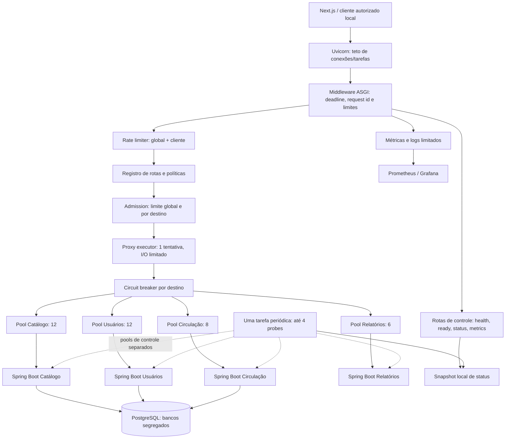
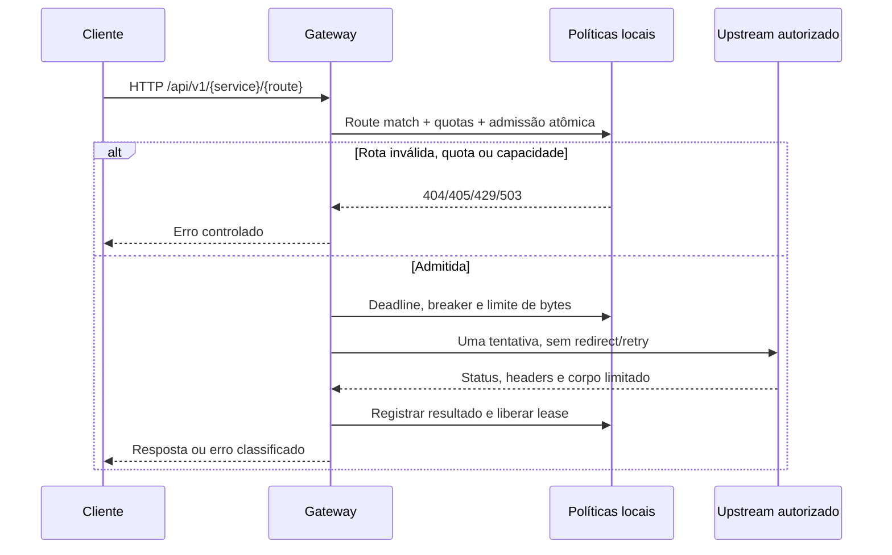
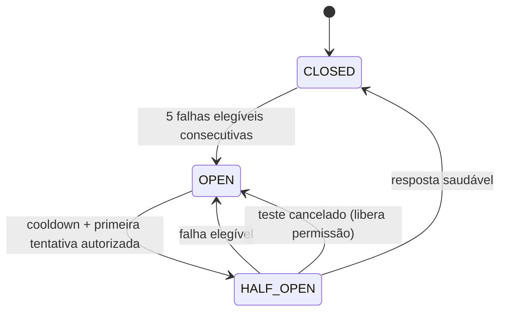

# SDD-001 — INKO Gateway Resilience & Capacity

| Campo | Valor |
|---|---|
| Projeto | INKO — Gestão de biblioteca de mangás e HQs |
| Versão | 1.1 — revisão arquitetural incorporada |
| Data | 12/11/2026 |
| Baseline | `DevAngeloOliveira/Inko`, `main`, commit `6cc015dde77593aeead1f0d6f73dd36386fae427` |
| Escopo | Gateway FastAPI, contratos de capacidade, proteções de transporte, integração e observabilidade |
| Pré-requisitos | ADR-001; Docker Compose; CI; SonarCloud; lockfile Python |
| Dependências futuras | SDD-002 (domínio e consistência), SDD-003 (performance e falhas), SDD-004 (implementação funcional) |
| Status | Especificação. Evidências de execução e pendências ficam no relatório operacional. |

## 1. Resumo executivo

O INKO deve manter a arquitetura poliglota existente — Next.js, FastAPI, quatro serviços Spring Boot e PostgreSQL — e tornar seu caminho de entrada previsível sob carga. O gateway continuará assíncrono, mas será um proxy com **admissão limitada, isolamento de capacidade por destino, prazo absoluto por requisição, limites de bytes, rate limiting e circuit breakers**.

O requisito central é limitar a amplificação de trabalho: no escopo deste SDD, uma requisição de negócio admitida pode iniciar no máximo **uma tentativa HTTP upstream**. A rota técnica de status passa a ler um snapshot local, atualizado por um único ciclo periódico de quatro sondas. Não haverá retry automático, filas de trabalho ilimitadas, fan-out dependente de dados ou chamadas recursivas. O limite é por processo e será demonstrado por testes; escalar workers ou réplicas requer recalcular todos os orçamentos.

As decisões numéricas são hipóteses de configuração inicial para um ambiente acadêmico local de baixo custo. Não são afirmações de throughput já medido. O sistema permanece executável pelos sete containers atuais, sem Redis, Kafka, Kubernetes ou servidor pago.

## 2. Diagnóstico rastreável da baseline

### 2.1 Evidências do repositório

| Evidência | Situação observada | Implicação |
|---|---|---|
| `apps/gateway/inko_gateway/main.py` | Um `AsyncClient(timeout=5.0)` no lifespan; mapa fixo de quatro destinos | Há reuso de conexões, mas não isolamento por destino nem deadline fim a fim |
| Mesmo arquivo, `services_status` | `asyncio.gather` dispara quatro GETs de health a cada acesso | Amplificação de 4 chamadas por consulta; acessos simultâneos repetem sondagens |
| Mesmo arquivo, `proxy` | Proxy genérico; lê `request.body()` e `response.content`; todos os `RequestError` retornam 503 | Materialização sem teto próprio de bytes, rotas amplas e classificação insuficiente de falhas |
| `apps/gateway/tests/test_health.py` | Dois testes: health e serviço desconhecido | Não comprova isolamento, deadline, backpressure, cancelamento ou integridade do proxy |
| `apps/gateway/pyproject.toml`, `uv.lock` | Python >=3.13, FastAPI, Uvicorn, HTTPX; pytest como extra; lock versionado | Implementação pode preservar stack e instalação binária já adotadas |
| `apps/gateway/Dockerfile` | Python 3.13, uv, usuário não root, Uvicorn sem parâmetros explícitos de capacidade | Capacidade do servidor deve ser declarada e testada |
| `compose.yaml` | Sete serviços, rede interna, Gateway e Web vinculados a localhost, health checks | Sem necessidade de novos containers obrigatórios |
| `services/*/src/main/resources/application.yaml` | Health/info/Prometheus; três datasources; não há pools explicitamente dimensionados | Alinhar capacidade downstream antes de ampliar o tráfego |
| `services/*/HealthController.java` | Serviços oferecem `/api/v1/ping`; ainda não há API funcional de domínio | Não inventar contratos de CRUD, empréstimos ou relatórios reais neste SDD |
| `apps/web/app/system/status/page.tsx` | `fetch` sem cache e timeout de 6 s; consome `services[]` com `up/down` | Preservar contrato e mostrar informação obsoleta explicitamente |
| `scripts/ci/smoke-compose.sh` | Verifica health, quatro pings, status dos quatro serviços, três bancos e assets | Manter compatibilidade e acrescentar cenários de recuperação |
| `infra/observability/prometheus/prometheus.yml` | Scrape dos serviços Java; Gateway e Web via Blackbox | Faltam métricas de capacidade internas do Gateway |
| `.github/workflows/ci.yaml`, `integration.yaml` | Testes Python/Java/Web, build Docker, smoke integrado, validação de configs | Reutilizar workflows, sem duplicar o pipeline |

### 2.2 Classificação dos riscos

| ID | Risco | Prioridade |
|---|---|---|
| R1 | Carga de entrada excede capacidade downstream, acumulando tarefas e conexões | Alta |
| R2 | Serviço lento ocupa capacidade do pool compartilhado e prejudica outros destinos | Alta |
| R3 | Quatro probes por acesso de status, mesmo quando a informação não mudou | Alta |
| R4 | Corpo/resposta ilimitados e clientes lentos mantêm memória e slots ocupados | Alta |
| R5 | Timeouts por fase confundidos com deadline total; cancelamento não libera tudo | Alta |
| R6 | Falhas repetidas continuam disparando chamadas; futuras tentativas podem duplicar escritas | Alta |
| R7 | Proxy genérico encaminha rotas não explicitamente autorizadas | Alta |
| R8 | Ausência de medições internas impede distinguir gargalo, sobrecarga e erro de dependência | Média |
| R9 | Limites locais multiplicam-se silenciosamente ao adicionar réplicas/workers | Média |

A baseline não contém chamadas recursivas entre serviços: não foi observado crescimento exponencial no código atual. O risco é preventivo e se torna crítico quando consultas de domínio, agregações, retries e encadeamentos forem introduzidos.

### 2.3 Qualidade e governança existentes

Na consulta ao commit de referência, os jobs de Java, Gateway, Web e Compose estavam aprovados. O check nativo SonarCloud aparece `neutral` na main e a auditoria rigorosa `Inspect SonarCloud main baseline` aparece com falha. A última auditoria registrada na conversa anterior confirmou Security A e zero issues de segurança abertas, mas Quality Gate `NONE`. Este SDD não declara um novo resultado do SonarCloud nem presume que a pendência administrativa tenha sido resolvida.

Ajustar a definição de New Code e obter análise correspondente ao commit da main continua sendo uma condição de governança. A auditoria não deve tomar resultados de um commit anterior como prova do commit atual; eventual sincronização do scanner/check deve ser tratada na trilha DevOps, sem reduzir o Quality Gate. O merge da implementação só será considerado completo após os critérios de qualidade aplicáveis serem demonstrados.

## 3. Escopo e não objetivos

### Dentro do escopo

- Refatorar Gateway em módulos testáveis, mantendo FastAPI, HTTPX, Uvicorn e Python 3.13.
- Definir contratos de admissão, rate limiting, bulkhead, deadline, proxy seguro, tratamento de falhas e observabilidade.
- Remover amplificação de status por cache/snapshot compartilhado.
- Preservar as rotas health, status e os quatro pings existentes, com testes de compatibilidade.
- Tornar explícito o orçamento de conexões e o perfil de execução local; validar limites e recuperação com testes determinísticos e HTTP real.
- Integrar métricas ao Prometheus existente; ajustar a configuração do Next.js de diagnóstico quando necessário.
- Definir guardrails que os serviços de domínio deverão respeitar.

### Fora do escopo

- Implementar regras de acervo, empréstimos, devoluções, multa ou autenticação funcional.
- Implementar idempotência persistida na Circulação, transações distribuídas, replicação, mensageria, CQRS ou cache de domínio.
- Prometer SLO de produção ou throughput sem benchmark; publicar nova versão GHCR ou executar deploy externo.
- Introduzir Redis ou um gateway gerenciado para resolver coordenação entre réplicas antes de existir essa necessidade.
- Alterar os esquemas dos bancos ou abrir portas internas na rede pública. O edge Caddy atual mantém `/api/*` bloqueado.

## 4. Arquitetura-alvo



O diagrama representa componentes lógicos. No código, o breaker terá sua permissão reservada após a leitura válida do corpo e imediatamente antes do despacho; o executor controla o resultado e a liberação dos recursos. Nenhuma chamada deve ser iniciada antes de todas as proteções exigidas pela política da rota.

### 4.1 Responsabilidades

- **Gateway:** roteamento, validação de fronteira, admissão, prazo, quotas, transporte, isolamento, resposta de erro e telemetria. Não contém regra de multa nem decide disponibilidade de exemplar.
- **Microsserviços:** autoridade sobre domínio e persistência; limites de threads/conexões; validação de dados; segurança de negócio; transações e idempotência futura.
- **Frontend:** debounce, cancelamento de consultas obsoletas, deduplicação por chave, paginação e feedback de sobrecarga. Não é uma fronteira de segurança.
- **Observabilidade:** evidência mensurável de utilização, rejeições, falhas e amplificação. Não substitui os limites.

## 5. Modelo formal de capacidade

### 5.1 Orçamento de requisições e amplificação

Para uma janela T, sejam A(T) as requisições de negócio admitidas e U(T) as tentativas upstream iniciadas por elas. A política inicial exige U(T) ≤ A(T), contabilizando por requisição desde sua admissão até o encerramento (ou usando contadores cumulativos alinhados; janelas curtas podem cruzar limites temporais). Cada requisição ordinária possui `max_upstream_attempts = 1` e `max_fanout = 1`. Rejeições, erros de validação e circuitos abertos geram zero chamadas.

Status é contabilizado separadamente: a tarefa de controle pode iniciar até quatro sondas a cada 5 s por processo; acessos HTTP a `/api/v1/system/status` não iniciam sondas adicionais. Um ciclo de bootstrap precede a aceitação de requisições. O Compose permite iniciar o Gateway assim que as dependências tiverem sido iniciadas, inclusive se alguma ainda estiver degradada. Taxa sustentada máxima do plano de controle: 4/5 = 0,8 tentativa/s por processo, além dos efeitos de fronteira da janela.

A carga total de entrada não é igual à capacidade de processamento. A Lei de Little (`L = λ × W`, em regime estável e com unidades consistentes) é uma aproximação útil: se a latência média sobe, a concorrência necessária para manter o mesmo throughput aumenta. O sistema não deve aumentar L indefinidamente para compensar a degradação: deverá rejeitar excessos.

**Exemplo de orçamento:** com 8 operações simultâneas na Circulação e duração média de 0,2 s, o teto teórico simplificado seria 40 operações/s naquele destino, antes dos demais gargalos. Se a média passar para 1 s, o teto cai para 8/s. Não se trata de capacidade medida, nem de uma garantia de taxa de sucesso.

O SDD-002 deverá estabelecer um grafo acíclico de chamadas de domínio, número máximo de chamadas por operação e fronteiras de transação. O Gateway não consegue limitar sozinho chamadas que um serviço inicia de forma independente; portanto, nenhuma expansão desse grafo é autorizada por este SDD.

### 5.2 Envelope inicial (por processo Gateway)

| Parâmetro | Valor inicial | Semântica |
|---|---:|---|
| Workers Uvicorn | 1 | Uma instância e um event loop |
| Limite Uvicorn | 64 | Guarda externo, considera conexões/tarefas do servidor |
| Backlog socket | 128 | Proteção do listener; não é fila de negócio |
| Keep-alive servidor | 5 s | Conexões ociosas |
| Slots negócio | 38 | Requisições admitidas, mantidos até fim/cancelamento |
| Slots controle HTTP | 6 | Separados dos slots de negócio |
| Fila de admissão | 0 | Try-acquire imediato; 503 se não houver capacidade |
| Conexões HTTPX negócio | Até 38 | Quatro pools independentes, HTTP/1.1 |
| Conexões HTTPX sondas | Até 4 | Um pool de 1 por destino, separado |
| Rate global negócio | 60 req/s, burst 32 | Token bucket local |
| Rate por cliente negócio | 30 req/s, burst 16 | Token bucket por endereço do peer confiável |
| Estado de clientes | 1.024 entradas, TTL 120 s | Remoção de expirados; bucket compartilhado restritivo quando cheio |
| Deadline negócio | 2.000 ms | Monotônico, inclui leitura do corpo, admissão, upstream e envio |
| Corpo de negócio | 64 KiB | Limite efetivo de bytes, não apenas Content-Length |
| Resposta upstream | 1 MiB | Bytes lidos; sem download/stream de grandes arquivos |
| Paginação futura | default 20, máximo 100 | Contrato a aplicar nas rotas que forem criadas |

A escolha de 38 slots globais é intencional: a soma dos quatro limites por destino coincide com o teto, evitando que o teto global elimine a capacidade reservada de um serviço quando os outros três saturam. Um limite global menor pode ser adotado mediante política explícita de reserva/prioridade, nunca por ajuste incidental.

A soma de 38 slots de negócio e 6 slots de controle é 44; o teto externo do Uvicorn é uma defesa adicional e não garante que todos os 44 slots estejam sempre acessíveis. Conexões ociosas, backlog e protocolo também consomem recursos; sob saturação externa até `/health` pode receber 503. Se a evidência mostrar necessidade de isolamento operacional adicional, considerar listener separado de gerenciamento numa etapa futura.

O máximo lógico de buffers de negócio é aproximadamente 38 × (64 KiB + 1 MiB) = 40,375 MiB, sem contar cópias, buffers de protocolo, tarefas, objetos Python, cabeçalhos, logs e runtime. Não confundir essa conta com RSS máximo. Medir memória do container e usar um perfil de teste inicialmente com 1 vCPU e 512 MiB para Gateway, sujeito a ajuste documentado.

### 5.3 Limites por destino

| Destino | Slots negócio / max_connections | max_keepalive_connections | Pool controle | Deadline absoluto da operação |
|---|---:|---:|---:|---:|
| Catálogo | 12 | 6 | 1 | 2 s |
| Usuários | 12 | 6 | 1 | 2 s |
| Circulação | 8 | 4 | 1 | 2 s |
| Relatórios | 6 | 3 | 1 | 2 s |

O pool não é o bulkhead: o pool controla conexões; a admissão controla operações/tarefas. Cada destino terá ambos. Os clientes HTTPX são criados uma vez no lifespan, fechados no shutdown, com `trust_env=False`, `follow_redirects=False`, `http2=False`, transporte sem retries e base URL fixa validada no startup. Desativar redirecionamentos impede que um upstream redirecione o proxy para destino não autorizado.

### 5.4 Alinhamento downstream

Os quatro serviços têm health/metrics, mas não há API real de negócio. Na etapa de implementação, medir limites de Tomcat/CPU e explicitar no perfil local parâmetros de threads, conexões e backlog — hipótese inicial: 24 threads máximas, 64 conexões e backlog 16 por serviço, após confirmar propriedades e comportamento na versão Spring Boot efetiva. Para os três datasources, começar com Hikari max 6, min idle 1 e aquisição ≤500 ms; total potencial de 18 conexões de aplicação, mais administração e migrações. Verificar `SHOW max_connections`, pools e conexões reais do PostgreSQL antes de fixar.

O SDD-001 especifica o contrato de capacidade, não afirma que esses valores já estão aplicados. O SDD-002 deve definir limites de SQL, transação e operações concorrentes de domínio. O cancelamento HTTP do Gateway não garante cancelamento da operação Java/SQL nem rollback. Uma escrita com timeout pode ter sido confirmada no servidor: nunca repeti-la automaticamente.

## 6. Pipeline de requisição e políticas



### 6.1 Ordem e propriedade dos recursos

1. Uvicorn aplica guarda de transporte. Middleware ASGI inicia relógio monotônico e contexto de request ID, valida limites básicos de caminho/cabeçalhos, identifica rotas de controle sem ler corpo.
2. Route registry valida método e caminho e determina política; desconhecido → 404, método conhecido não permitido → 405 com `Allow` quando aplicável. Rate limiting de negócio aplica-se inclusive a tentativas inválidas (antes de lookup detalhado), evitando varredura sem quota; rotas de controle usam slots próprios.
3. Para negócio, verificar quota global/cliente em transação local curta (sem I/O) e reservar global+destino atomicamente, sem esperar. Se não há slot: 503; se quota insuficiente: 429. Não manter semáforos com filas de waiters ilimitadas, nem usar `locked()` como garantia de aquisição. Implementar `try_acquire` em estado privado do event loop, com teste de corrida e `finally` idempotente.
4. Ler corpo em chunks limitados sob prazo absoluto. Só depois reservar permissão do breaker imediatamente antes do envio, evitando ocupar half-open com upload lento; se circuito já estiver aberto, pode-se rejeitar antes da leitura. Revalidar no instante de envio. Limitar número de tentativas via `RequestBudget.consume_attempt()`; nenhuma operação upstream fora do executor protegido, exceto o plano de controle separado.
5. Executar chamada no cliente/pool do destino e ler resposta em stream até limite. Liberar resposta HTTPX em todos os caminhos, inclusive erro e cancelamento. Contabilizar resultado do breaker uma vez. Retornar status original permitido ou erro normalizado.
6. Liberar lease de negócio somente após concluir envio ASGI (ou abortar conexão). Um cliente que recebe lentamente não pode liberar slot prematuramente. Timeout antes do primeiro byte permite erro estruturado; após início da resposta não é possível trocar status: encerrar transmissão e registrar o motivo.

Utilizar um middleware ASGI puro ou um wrapper equivalente que cubra `receive`/`send`, não apenas a duração da função de endpoint. O deadline precisa englobar operações assíncronas canceláveis; código bloqueante/CPU-bound não pode ficar dentro do event loop. A limpeza deve ser protegida contra interrupção, sem `shield` indiscriminado nem tarefas órfãs.

### 6.2 Rate limiting

Token bucket de tempo monotônico, O(1) amortizado por acesso, estado limitado. Verificar e debitar os dois buckets em uma única seção crítica local, sem I/O; nunca permitir que chaves ilimitadas criem memória ilimitada. Expirar chaves com estrutura de ordenação/limpeza amortizada, sem varrer todas as chaves a cada requisição. Ao atingir 1.024 clientes ativos, usar bucket de overflow com quota menor (inicial 5 req/s e burst 5), sem descartar continuamente chaves ativas para contornar a quota. Limites inteiros validados na configuração.

Usar o peer da conexão (`request.client.host` ou ASGI scope equivalente). Não confiar em `X-Forwarded-For` ou cabeçalhos de identidade de entrada. No baseline, Next.js pode ser um cliente agregado: sua quota pode limitar todo o tráfego originado no BFF; esse efeito é documentado. Quando autenticação real existir, definir chave por usuário autenticado e proxies confiáveis de forma explícita. A quota global é obrigatória mesmo com identidade ausente.

Quotas por processo não são globais quando houver múltiplas réplicas. Antes de escalar, decidir entre repartir a quota/capacidade por réplica ou coordenação externa; não adicionar Redis agora. Requisições rejeitadas não fazem chamada upstream. HTTP 429 retorna `Retry-After` inteiro calculado a partir do bucket, com mínimo de 1 segundo; o frontend não deve iniciar retry em loop.

### 6.3 Deadline e timeouts

- Prazo absoluto: `deadline = loop.time() + 2.0`, controlado por relógio monotônico. Reservar 50 ms dentro desse prazo para tentar enviar um erro antes do início da resposta. Após iniciar a resposta, abortar o envio em caso de timeout. O prazo mede a entrega ao servidor ASGI.
- Fases HTTPX iniciais: connect 250 ms, pool 50 ms, write 250 ms, read 1.200 ms, cada uma limitada pelo saldo de deadline. Read/write são timeouts de inatividade da fase, não orçamento total; o deadline limita a soma e chunks sucessivos.
- Não iniciar tentativa quando o saldo for insuficiente para o despacho. Cancelamento do cliente/ASGI e expiração devem abortar a tentativa e liberar recursos, sem engolir `CancelledError`. Detectar desconexão via mecanismo ASGI seguro, sem consumidores concorrentes de `receive`; testar com TCP real.
- Propagar apenas orçamento restante gerado pelo Gateway se e quando um serviço implementar o contrato interno (`X-INKO-Timeout-Ms` com teto validado); não transmitir relógio monotônico absoluto entre processos. Cabeçalhos de orçamento fornecidos pelo cliente são descartados. O SDD-002 deve validar limites locais e reduzir orçamento em cada hop. Até lá, a garantia de deadline é do Gateway, não do trabalho backend após cancelamento.
- Retry automático: 0 para todas as rotas da v1.0. Uma futura exceção GET idempotente, declarada no registro, poderá permitir 1 retry apenas com deadline e orçamento de tentativa remanescente, com backoff/jitter e análise de amplificação. Requer ADR e testes específicos. Escritas nunca são repetidas automaticamente pelo Gateway.

### 6.4 Circuit breaker por serviço

Estado local `CLOSED`, `OPEN`, `HALF_OPEN`, independente por serviço. Defaults: abrir com 5 falhas consecutivas elegíveis; cooldown 10 s; apenas 1 tentativa half-open por serviço; sucesso válido fecha e zera contador, falha elegível reabre; nenhuma fila esperando o circuito. Acesso durante OPEN ou half-open ocupado → 503 e `Retry-After` quando calculável.



Resultados: falha de conexão/protocolo, timeout real upstream e 5xx contam como falha; 2xx válidos e 4xx de aplicação exceto 429 demonstram resposta e zeram a sequência de falhas; 429 upstream, cancelamento do cliente, rejeição local, validação e `PoolTimeout` são neutros. Uma resposta inválida ou acima do contrato de tamanho é falha de protocolo/contrato. Na half-open, resultado neutro libera a tentativa e volta a OPEN por cooldown de 1 s (sem considerar recuperação). Sondas de health não modificam breaker de negócio. A sequência é definida pela ordem de conclusão das tentativas da geração corrente.

Controlar transições em seção crítica curta, sem `await` e sem lock durante I/O. Cada autorização recebe geração/token; respostas antigas de operações que começaram antes de uma transição não podem fechar circuito de uma geração posterior. Uma tentativa é finalizada exatamente uma vez. Se o contador de falhas atingiu limiar, as operações já em voo não são repetidas nem podem aumentar concorrência. Testes com relógio injetável e corrida half-open são obrigatórios.

### 6.5 Sondas de status: zero fan-out por acesso

Uma única tarefa por processo Gateway faz o refresh no lifespan; bootstrap tenta os quatro healths em paralelo com limite global de quatro e timeout absoluto de 1 s para o ciclo, depois publica snapshot imutável completo. Novos ciclos iniciam com espaçamento de pelo menos 5 s, sem sobreposição, sem retry, sem depender da quantidade de clientes. Cada sonda usa pool de controle independente (1 conexão) e resposta pequena (16 KiB). Validar HTTP 200 e payload de health esperado `status=UP` para marcar `up`; timeout, erro de contrato e indisponibilidade são `down`.

`GET /api/v1/system/status` lê snapshot em O(1) com estrutura fixa de quatro serviços e devolve `services` no formato existente, adicionando `observedAt` (UTC), `ageMs`, `stale` (idade superior a 15 s) e `refreshIntervalMs`. A semântica de `up/down` permanece última observação; se stale, o frontend deve indicar que o estado está desatualizado, sem afirmar saúde atual. Respostas não disparam refresh. Encerramento cancela e aguarda a tarefa antes de fechar pools. Health local não consulta dependências. Readiness (`/ready`) indica inicialização do Gateway e disponibilidade de seus recursos, não que todos os serviços estão saudáveis.

O smoke Compose mantém a exigência de todos os quatro serviços `up`, mas passa a aguardar snapshot fresco por tempo limitado, sem mudar o requisito para aceitar degradação. Testar 100 acessos em lotes de até seis no mesmo ciclo: todos leem o snapshot publicado. Em uma rodada separada com 100 acessos simultâneos, aceitar 503 sob saturação e comprovar zero sondas disparadas pelos acessos. Sob indisponibilidade, a rota de status continua respondendo com `down` enquanto houver capacidade no plano de controle.

## 7. Contratos HTTP e segurança de fronteira

### 7.1 Registro de rotas

| Método | Rota externa v1.0 | Destino / contrato |
|---|---|---|
| GET | `/health` | Local, `{"service":"gateway","status":"ok"}` preservado |
| GET | `/ready` | Local, readiness de infraestrutura |
| GET | `/api/v1/system/status` | Local, snapshot compatível |
| GET | `/metrics` | Local, gerenciamento na rede interna; nunca proxyado |
| GET | `/api/v1/{service}/ping` | Serviço conhecido → `/api/v1/ping`; resposta original |

Os únicos serviços válidos são `catalogo`, `usuarios`, `circulacao`, `relatorios`. Substituir wildcard aberto por registro explícito de operações e políticas, preservando o formato externo `/api/v1/{service}/...`. Rotas de domínio futuras serão adicionadas por contrato OpenAPI do serviço e testes, com métodos, orçamento, parâmetros e classificação de leitura/escrita; não criar CRUD fictício neste SDD. O ping de serviço desconhecido segue retornando 404. Restringir `/docs`/`openapi.json` ao ambiente local/interno conforme configuração; não expor `/metrics` pelo Next/Caddy.

### 7.2 Fronteira de confiança e limites de transporte

- Endereços upstream vêm exclusivamente da configuração validada; aceitar somente `http/https` com host e porta autorizados, sem credenciais, query ou fragmento. Em Compose, nomes fixos dos quatro serviços. Não concatenar URLs a partir de texto arbitrário nem permitir redirect, SSRF, caminhos absolutos, barras invertidas, dot segments ou codificações ambíguas de separadores. Validar caminho decodificado e representação bruta quando disponível; não usar `urljoin` com entrada livre.
- Teto inicial para caminho 1 KiB e query 4 KiB, parâmetros por rota, máximo 32 parâmetros; parâmetros repetidos só quando o contrato os admite, sem perda silenciosa. Teto agregado de cabeçalhos aceitos 16 KiB e no máximo 64 campos; considerar limites do parser antes da aplicação. Não alegar que middleware limita bytes que já foram aceitos pelo servidor ASGI.
- Request body: rejeitar Content-Length acima de 64 KiB antes da leitura; verificar formato/consistência e efetivamente contar bytes em `receive`/stream, inclusive chunked ou ausência de Content-Length. Limite de corpo é por operação. JSON como padrão futuro, rejeitar tipo/encoding não permitido, uploads/multipart/streaming fora do escopo. Evitar cópias extras e materialização ilimitada. Usar prazos no recebimento de chunks.
- Resposta: `client.stream`, contar bytes por chunk antes de armazenar, encerrar e fechar se exceder 1 MiB; por simplicidade do baseline, solicitar `Accept-Encoding: identity` e rejeitar encoding não suportado, evitando expansão de payload comprimido. Não confiar apenas no Content-Length do upstream. Nunca enviar cabeçalhos ou corpo parcial ao cliente antes de concluir validação quando o contrato for bufferizado.
- Encaminhar apenas `Accept`, `Content-Type` e cabeçalhos explicitamente aceitos (`Authorization` quando aplicável ao futuro contrato, `Idempotency-Key` para futura escrita, request ID, trace context validado). Não encaminhar cabeçalhos hop-by-hop (`Connection`, `Transfer-Encoding`, etc.), `Host`, cookies arbitrários, `Content-Length` calculado incorretamente, ou credenciais de serviço geradas pelo cliente. Na resposta, preservar `Content-Type`, status e cabeçalhos previstos por rota (`Retry-After`, `ETag`, `Location` quando seguro); recalcular tamanho, não copiar `Content-Encoding` de corpo decodificado. Sem redirecionamentos automáticos.
- Request ID validado/limitado (máximo 64 caracteres, formato restrito) ou gerado UUID; sempre ecoado. Não logar Authorization, corpo, e-mail, tokens, query completa ou identificadores pessoais. `traceparent` conforme W3C quando válido, gerar contexto seguro caso ausente/inválido; nunca usar request ID como label Prometheus.
- Rede: manter serviços Java internos e Gateway em localhost no Compose; o SDD não implementa autenticação/autorização. Uma allowlist de rotas não equivale a controle de acesso.

### 7.3 Semântica dos erros

Pings aceitam caminho literal, query vazia e corpo vazio. Um corpo não vazio dentro do teto recebe 400, um corpo acima do teto recebe 413 e redirecionamentos upstream recebem 502.

Adotar `application/problem+json` para erros produzidos pelo Gateway, com `type`, `title`, `status`, `code`, `requestId` e `detail` genérico (sem stack trace nem endereço interno). Exemplo:

```json
{
  "type": "about:blank",
  "title": "Serviço temporariamente indisponível",
  "status": 503,
  "code": "UPSTREAM_CAPACITY_EXHAUSTED",
  "requestId": "d0f622d0-6e0a-4f64-99c9-247bfb5adb80"
}
```

| Condição | HTTP | Código |
|---|---:|---|
| Serviço/rota desconhecido | 404 | `ROUTE_NOT_FOUND` |
| Método não autorizado na rota | 405 | `METHOD_NOT_ALLOWED` |
| Corpo acima do teto | 413 | `PAYLOAD_TOO_LARGE` |
| Tipo/encoding de requisição inválido | 415 | `UNSUPPORTED_MEDIA_TYPE` |
| Cabeçalhos acima do teto aceito | 431 | `HEADERS_TOO_LARGE` |
| Quota excedida | 429 | `RATE_LIMITED` |
| Sem slot global/destino ou pool local | 503 | `GATEWAY_OVERLOADED` / `UPSTREAM_CAPACITY_EXHAUSTED` |
| Circuito aberto ou half-open ocupado | 503 | `UPSTREAM_CIRCUIT_OPEN` |
| Timeout upstream/deadline aguardando upstream | 504 | `UPSTREAM_TIMEOUT` |
| Prazo expirado recebendo corpo do cliente (antes do upstream) | 408 | `REQUEST_TIMEOUT` |
| Falha de rede/protocolo, resposta inválida/excessiva | 502 | `UPSTREAM_BAD_RESPONSE` |
| Status HTTP de aplicação recebido | Original | Semântica da API de domínio preservada |

A resposta 503/429 inclui `Retry-After` quando houver estimativa válida; não inventar tempo de recuperação do serviço. O guarda Uvicorn pode emitir erro 503 fora do middleware e sem o envelope JSON; isso é documentado e testado, não mascarado. Clientes devem tolerar esse fallback de transporte. Nenhum 4xx/5xx é convertido em 200. Se uma escrita futura expirar após despacho, estado é indeterminado para o cliente; o SDD-002 define idempotência persistente e consulta de resultado.

## 8. Organização de código e contratos internos

Proposta de estrutura (nomes em inglês mantêm convenções do código Python atual):

```text
apps/gateway/
  inko_gateway/
    main.py                 # composition root: app factory, lifespan
    config.py               # Settings imutáveis, validação de limites e destinos
    policies.py             # RoutePolicy, ServicePolicy, registry
    admission.py            # CapacityController, lease global + destino
    rate_limit.py           # TokenBucket, bounded client store
    circuit_breaker.py      # máquina de estados, generation tokens
    budget.py               # RequestBudget, deadline e attempts
    transport.py            # UpstreamTransport, clientes HTTPX/pools
    proxy.py                # executor e corpo/resposta limitados
    health.py               # snapshot, scheduler e plano de controle
    middleware.py           # ASGI lifecycle, request context, receive/send
    errors.py               # erros tipados e mapeamento HTTP
    telemetry.py            # métricas e logs com cardinalidade limitada
  tests/
    test_health.py
    test_route_policies.py
    test_admission.py
    test_rate_limit.py
    test_circuit_breaker.py
    test_budget.py
    test_proxy_limits.py
    test_proxy_resilience.py
    test_status_snapshot.py
    test_gateway_integration.py
    test_telemetry.py
```

As anotações na árvore são documentação do SDD, não comentários a incorporar aos arquivos de código (respeitar a exigência acadêmica de código sem comentários). Não criar uma classe por operação trivial. Usar composição e protocolos/interfaces quando houver dois usos concretos: relógio fake/real, transport mock/real e repositório de estado local quando necessário.

| Abstração | Contrato sugerido |
|---|---|
| `GatewaySettings`, `RoutePolicy` | `dataclass(frozen=True, slots=True)` e validação no startup; enum/valores fechados |
| `CapacityController.try_acquire(service)` | `Lease | None`; reserva global+destino sem espera e release idempotente |
| `TokenBucket` | Cálculo puro de reposição/consumo com relógio injetável; estado publicado atomicamente |
| `CircuitBreaker.try_permit(now)` | `Permit(generation) | None`; `record(permit, outcome)` exatamente uma vez |
| `RequestBudget` | Deadline imutável; contador de tentativas com autoridade exclusiva do executor |
| `UpstreamTransport` | `execute(request, policy, budget)`; I/O assíncrono, sem retry, stream fechado |
| `HealthSnapshot` | Tupla imutável de quatro estados e instante de observação; substituição atômica |
| `create_app(settings, transport_factory, clock)` | Dependency injection e lifespan por instância; sem estado mutável global de testes |

Separar funções puras (refill de token, classificação de falha, política, transformação de estados) de efeitos (HTTP, relógio real, métricas). Utilizar estruturas limitadas, evitar CPU-bound e I/O bloqueante no event loop. Estado mutável operacional fica encapsulado e é necessário para proteger recursos; não confundir imutabilidade das políticas com ausência de estado no processo.

### 8.1 Configuração e versionamento

Consolidar defaults em um único Settings e expor variáveis `INKO_GATEWAY_*` para limites, rate, deadline, breaker, TTL e URLs existentes. Validar valores positivos, soma dos slots por destino ≤ global quando política de reserva exigir, keep-alive ≤ conexões, teto de controle e worker count esperado, tamanho e tempo. Rejeitar configuração inválida no startup, sem fallback silencioso. Documentar unidades (ms, bytes, requests/s) e atualizar `.env.example` quando necessário sem incluir secrets. Não duplicar defaults divergentes entre Dockerfile/Compose/settings; CLI Uvicorn recebe valores compatíveis via configuração de execução documentada.

Preservar `uv.lock` e o comando CI `uv sync --locked --extra test --no-build --no-install-project`; adicionar dependência de métricas (preferência `prometheus-client`) somente com resolução de lockfile real e análise Sonar/Trivy. Não reinstalar dependências de modo inseguro. O projeto não requer novas credenciais, containers ou infraestrutura paga.

## 9. Observabilidade e capacidade mensurável

### 9.1 Métricas propostas (labels fechadas)

| Métrica | Tipo / labels |
|---|---|
| `inko_gateway_requests_total` | counter; route_id, method, outcome/status_class |
| `inko_gateway_request_duration_seconds` | histogram; route_id |
| `inko_gateway_inflight` | gauge; plane (`business`, `control`) |
| `inko_gateway_upstream_inflight` | gauge; service, plane |
| `inko_gateway_admission_rejections_total` | counter; service, reason |
| `inko_gateway_rate_rejections_total` | counter; scope (`global`, `client`, `overflow`) |
| `inko_gateway_upstream_attempts_total` | counter; service, plane, outcome |
| `inko_gateway_upstream_duration_seconds` | histogram; service, plane |
| `inko_gateway_pool_timeouts_total` | counter; service, plane |
| `inko_gateway_circuit_state` | gauge; service, valor 0/1/2 |
| `inko_gateway_circuit_transitions_total` | counter; service, to_state |
| `inko_gateway_status_snapshot_age_seconds` | gauge |
| `inko_gateway_client_buckets` | gauge |
| `inko_gateway_payload_rejections_total` | counter; direction, reason |

Usar métricas de tempo em segundos; buckets iniciais 0,01/0,025/0,05/0,1/0,25/0,5/1/2/3/5. Rotas usam identificadores fixos, não URL bruta; ausência de IDs de usuário, request ID, endereço IP e mensagens como labels. Tempo real de espera no pool só deve ser publicado se instrumentado por API suportada: no baseline medir contadores de PoolTimeout e duração total, não inventar gauge interno do HTTPX.

Amplificação de negócio: `sum(increase(inko_gateway_upstream_attempts_total{plane="business"}[5m])) / sum(increase(inko_gateway_requests_total{...}[5m]))`, com denominador de requisições **admitidas**, medido por contador dedicado `inko_gateway_admitted_total` e alinhamento de janelas. Tráfego de controle não entra no numerador nem denominador. Testes usam contadores exatos por request e não apenas a razão aproximada de janela. Esperado cumulativo ≤1.0, com ressalva de tentativas em trânsito na borda da janela.

Prometheus recebe job interno `inko-gateway` → `gateway:8000/metrics` no overlay de observabilidade existente. Expor na rede interna e no bind localhost do perfil local. O edge mantém o Gateway sem portas publicadas. Adicionar regras para taxa de rejeição sustentada, breaker aberto prolongado, snapshot stale e ausência de scrape. Grafana: painel de RPS, p95/p99, erros, rejeições, in-flight/limites, estado dos quatro breakers e amplificação. Limitar logs estruturados a metadados necessários; amostrar sucessos em carga e limitar logs repetitivos, sem suprimir contadores de erro. Alertas locais são suficientes para a disciplina; notificação externa fica fora do escopo.

### 9.2 Metas iniciais e método

- Em perfil local de referência, carga ordinária de 10 req/s distribuída entre pings durante 2 min: p95 ≤500 ms, p99 ≤1.500 ms, ≥99% respostas esperadas; hipótese a calibrar, não garantia. Registrar CPU, RAM, sistema operacional, Docker, versões, warmup e conjunto de dados/stub usado.
- Saturação: teste de chegada aberta (não somente VUs em loop fechado), cenário 120 req/s, incluindo upstream lento; verificar 429/503 explícitos, nenhum crescimento ilimitado de tasks/conexões, slots dentro dos tetos e conclusão/cancelamento. Contar também respostas do Uvicorn e requisições descartadas pelo gerador; não esconder saturação.
- Isolamento: saturar Relatórios com resposta de 1,5 s; continuar carga de baixa taxa nos outros destinos, com peers/quota global suficientes. Os limites de Relatórios não podem ocupar slots dos demais; p95 dos saudáveis deve permanecer próximo à baseline, hipótese até +100 ms em ambiente controlado. Testar separadamente saturação global, que pode prejudicar todos.
- Soak local de 10 min com carga moderada, observar RSS e event loop; comparar após warmup e cooldown, sem exigir RSS retorno exato devido a alocadores. Nenhuma tendência persistente de crescimento em slots, pools, tasks e buckets. Perfil com 512 MiB: meta inicial pico <80% após calibração; não confundir medição com limite de buffer.
- CI bloqueante usa invariantes determinísticas, testes reais de protocolo e smoke curto; benchmark absoluto de latência depende do hardware e entra inicialmente como relatório local/manual, não como gate flakey. SDD-003 consolida k6/Locust, cenários e baseline de desempenho a partir desses primeiros resultados.

## 10. Plano de testes e matriz de aceite

Usar pytest com relógio fake e HTTPX MockTransport para decisões/políticas; testes async via padrão compatível com pytest atual (fixtures `asyncio.run`/framework já instalado ou plugin com lock). Complementar com HTTP real (Uvicorn + upstream controlável), porque ASGITransport/MockTransport não comprovam comportamento de socket, pool, chunked, desconexão ou limite Uvicorn. O smoke Compose valida os quatro serviços reais; stubs de latência/falha ficam em testes/overlay descartável e nunca substituem os serviços em execução normal.

| ID | Cenário / método | Critério de aceite |
|---|---|---|
| AC-01 | Health, status, quatro pings e serviço desconhecido | Contratos preservados; status mostra quatro serviços; 404 sem upstream |
| AC-02 | 13+ operações simultâneas Catálogo, com barreira no upstream | ≤12 despachadas; excedentes 503 rápidos, sem fila de negócio |
| AC-03 | Todos os destinos saturados em teste controlado | Negócio ≤38; por destino ≤12/12/8/6; controle ≤6 |
| AC-04 | Relatórios degradado e chamadas saudáveis a Circulação | Não há consumo de slots/pool alheio; pings saudáveis concluem |
| AC-05 | Token bucket com relógio fake, burst, refill e peers | Excesso 429; Retry-After coerente; buckets ≤1.024 + overflow fixo |
| AC-06 | Corpo chunked/sem Content-Length/maior que teto | 413 antes de upstream; buffer e slot liberados; caso malformado tratado pelo servidor |
| AC-07 | Resposta excessiva/fragmentada, encoding indevido | 502 controlado; upstream fechado, sem resposta parcial antes da validação |
| AC-08 | Chunks contínuos que nunca excedem timeout de leitura | Deadline total limita a operação; 504 antes de resposta iniciada; nenhuma tentativa adicional |
| AC-09 | Cliente lento, desconexão TCP e cancelamento em cada fase | Lease/stream liberados; nenhuma tarefa órfã; resultado neutro quando cancelamento do cliente |
| AC-10 | 5 falhas elegíveis, cooldown e corrida de half-open | Abre, bloqueia novas tentativas, somente 1 half-open; sucesso fecha; resultado antigo não altera geração |
| AC-11 | 100 leituras em lotes e teste separado de saturação | 0 probes por acesso; somente ciclo programado com ≤4; snapshot age/stale corretos; 503 permitido sob saturação |
| AC-12 | Circuito aberto, rotas inválidas, quota/slots esgotados | Zero chamadas upstream para rejeições; nenhuma resposta de negócio falsa |
| AC-13 | Simulação de 4xx de aplicação, 429 upstream, 5xx, timeout e falha de conexão | Mapeamentos e contabilidade do breaker respeitam §6/§7 |
| AC-14 | Rota/caminho codificado, tentativa de SSRF, redirect e headers maliciosos | Nenhuma chamada a destino fora da allowlist; headers hop-by-hop/identidade descartados |
| AC-15 | 2.000 requisições de teste e contadores por request | Máximo de 1 tentativa por negócio admitido; sem retries e fan-out de dados |
| AC-16 | Shutdown com tarefas de probe e requests canceladas | Pools fechados; tarefas encerradas; sem estado vazando entre app factories |
| AC-17 | Scrape de métricas e muitos IDs distintos | Métricas corretas e labels de cardinalidade fixa; sem dados pessoais |
| AC-18 | Compose real, sete containers, status fresco, pings e assets | Smoke integrado aprovado; sem alteração/destruição de volumes do usuário |
| AC-19 | Config inválida, startup e rollout | Falha explícita; política correta de workers; smoke comprova compatibilidade |
| AC-20 | Carga local, stress/soak | Evidência reproduzível; limites nunca violados; resultados não apresentados como SLO de produção |

Para AC-02/03, separar teste de admissão do rate limiter: usar relógio/quotas de teste que não bloqueiem a condição de concorrência antes da admissão. Em teste end-to-end, validar ambos juntos. No teste de desligamento, assumir Docker Compose/CI descartável; `down -v` é permitido apenas no runner isolado criado pelo workflow, jamais no ambiente de desenvolvimento com dados do usuário.

## 11. Plano de execução incremental

### E1 — Contratos e estrutura

- Registrar o SDD e ADR complementar (aceitação após revisão). Implementar app factory, Settings, RoutePolicy e RequestBudget. Preservar testes existentes e adicionar contrato de rotas.
- Versionar defaults e env; nenhuma mudança de regra de negócio. Commits: `docs(architecture): specify gateway resilience and capacity budgets`, `refactor(gateway): introduce app factory and route policies`.

### E2 — Controle de capacidade e transporte

- Middleware ASGI, slots globais/por destino, rate limiting limitado, clientes HTTPX por destino, deadline e limites de request/response, erro estruturado. Testes AC-02/03/05/06/07/08/09/12/14/15.
- Commits: `feat(gateway): bound request admission and client rate`, `feat(gateway): isolate upstream pools and enforce deadlines`, `fix(gateway): constrain proxy payloads and route forwarding`.

### E3 — Isolamento de falhas e status

- Circuit breaker local com generation token, snapshot periódico e health/ready; atualização mínima do diagnóstico Next.js. Testes AC-01/04/10/11/13/16.
- Commits: `feat(gateway): add per-service circuit breakers`, `perf(gateway): decouple health probes from status traffic`, `fix(web): display gateway status freshness`.

### E4 — Observabilidade e validação

- Instrumentar métricas, scrape e alertas; teste de cardinalidade, smoke Compose e teste HTTP real com upstream controlável. Ajustar Docker/Uvicorn e documentar perfil de capacidade; dimensionamento Java/DB confirmado antes de ativar limites downstream. Registrar relatório de carga inicial.
- Commits: `feat(observability): expose gateway capacity and resilience metrics`, `test(gateway): exercise saturation and upstream failure over HTTP`, `ci(integration): validate gateway capacity and health contracts`, `docs(devops): document gateway runtime limits and load profile`.

### E5 — Governança e entrega

- PRs pequenos em ordem, cada um green e reversível. Preservar SonarCloud/Trivy, lockfiles e workflows existentes; sem automação de commits do bot.
- Reexecutar `uv lock --check`, instalação binária locked, pytest, build do Gateway Docker, smoke completo, validação Prometheus/Caddy/Compose. Exigir gate do PR antes da integração. Na main, esperar no máximo 10 minutos e registrar SHA integrado, analysisId, gate OK e Security Rating A da revisão efetivamente analisada. Corrigir Quality Gate `NONE` na configuração SonarCloud antes de declarar encerramento integral.
- Rodar experimentos locais, revisar decisões e aceitar ADR. Só então considerar SDD-001 encerrado e autorizar a implementação dos contratos do SDD-002. Nenhuma tag ou release é criada automaticamente pela implementação; atualizar manifesto somente em PR próprio e deliberado após gates.

## 12. Definition of Done e estratégia de rollout

- AC-01 a AC-19 aprovados com evidência; AC-20 executado e documentado, metas calibradas e desvios justificados (sem falsificar resultados).
- Todos os limites são explícitos, configuráveis, validados no startup e testados. Não existe retry implícito nem fila de negócio ilimitada. Zero fan-out por acesso de status. Métricas demonstram limites e erros.
- Testes reais de rede complementam mocks; logs não contêm segredos. Manter código sem comentários conforme requisito acadêmico, documentação em Markdown e testes que expliquem invariantes.
- CI, testes de integração, segurança e SonarCloud aprovados; Quality Gate da main calculado e Security A verificado. Se dependência administrativa impedir o gate, status é pendente, não verde.
- Documentar comandos locais, baseline e perfil do hardware. A entrega roda com sete containers normais; overlay Prometheus/Grafana permanece opcional.
- Fazer rollout local primeiro (`docker compose up -d --build --force-recreate gateway`, e web caso alterado). Conferir status/health e métricas, depois `docker compose ps` e smoke. Não remover volumes. Reverter o PR ou usar imagem/revisão anterior conhecida se houver regressão; não retaggear a release v0.4.0.

## 13. Decisões e trade-offs

| Decisão | Alternativa rejeitada agora | Justificativa |
|---|---|---|
| Um worker, estado local limitado | Vários workers/Redis imediato | Reduz complexidade; orçamento verificável, escalabilidade futura explícita |
| Sem fila de negócio, fail-fast | Queue ilimitada ou espera longa | Protege memória e deadline; picos podem receber 503, cliente deve lidar |
| Pool/bulkhead por serviço | Pool único maior | Isolamento concreto; mais conexões ociosas possíveis, limitadas por keep-alive |
| Zero retry | Retry em todas as falhas | Evita amplificação e duplicação de escritas; futuro retry só via contrato e medição |
| Snapshot periódico | Probes por acesso | Remove amplificação, aceita staleness controlada |
| Allowlist de rotas | Proxy wildcard aberto | Contratos auditáveis; novas rotas exigem registro e testes |
| Buffer limitado | Streaming de payload arbitrário | Erro consistente antes de enviar resposta; limita exportações/uploads até haver caso real |
| Prometheus existente | Stack nova de observabilidade | Reutiliza infraestrutura e reduz custo; tracing distribuído completo fica para evolução |
| Timeouts monotônicos + fase | Timeout HTTPX único | Limite fim a fim local, sem prometer interrupção de efeitos remotos |

### Critérios para reconsiderar

- Escalar replicas/workers somente com medição de CPU/latência e capacidade downstream; recalcular `N × quotas`, `N × pools`, `N × probes` e necessidade de coordenação. Definir budgets globais no SDD-003/ADR posterior.
- Acrescentar cache de domínio ou mensageria somente com evidência de consultas repetidas ou necessidade de consistência assíncrona; não reutilizar cache de health para dados funcionais.
- Aumentar limites de bytes ou introduzir streaming apenas com contrato por rota, mecanismos de cancelamento, backpressure e testes específicos.
- Definir SLOs reais com dados de carga e ambiente de execução. Sem deploy externo neste projeto acadêmico.

## 14. Referências e rastreabilidade

Baseline GitHub (imutável): [commit 6cc015d](https://github.com/DevAngeloOliveira/Inko/commit/6cc015dde77593aeead1f0d6f73dd36386fae427).

- [Gateway main.py](https://github.com/DevAngeloOliveira/Inko/blob/6cc015dde77593aeead1f0d6f73dd36386fae427/apps/gateway/inko_gateway/main.py), [testes atuais](https://github.com/DevAngeloOliveira/Inko/blob/6cc015dde77593aeead1f0d6f73dd36386fae427/apps/gateway/tests/test_health.py), [Dockerfile](https://github.com/DevAngeloOliveira/Inko/blob/6cc015dde77593aeead1f0d6f73dd36386fae427/apps/gateway/Dockerfile).
- [Compose](https://github.com/DevAngeloOliveira/Inko/blob/6cc015dde77593aeead1f0d6f73dd36386fae427/compose.yaml), [CI](https://github.com/DevAngeloOliveira/Inko/blob/6cc015dde77593aeead1f0d6f73dd36386fae427/.github/workflows/ci.yaml), [integração](https://github.com/DevAngeloOliveira/Inko/blob/6cc015dde77593aeead1f0d6f73dd36386fae427/.github/workflows/integration.yaml), [smoke](https://github.com/DevAngeloOliveira/Inko/blob/6cc015dde77593aeead1f0d6f73dd36386fae427/scripts/ci/smoke-compose.sh).
- [Prometheus atual](https://github.com/DevAngeloOliveira/Inko/blob/6cc015dde77593aeead1f0d6f73dd36386fae427/infra/observability/prometheus/prometheus.yml), [ADR-001](https://github.com/DevAngeloOliveira/Inko/blob/6cc015dde77593aeead1f0d6f73dd36386fae427/docs/architecture/ADR-001-monorepo.md), [status frontend](https://github.com/DevAngeloOliveira/Inko/blob/6cc015dde77593aeead1f0d6f73dd36386fae427/apps/web/app/system/status/page.tsx).

Referências técnicas que fundamentam as propostas, não resultados de implementação:

- [HTTPX: Resource Limits](https://www.python-httpx.org/advanced/resource-limits/) e [Timeouts](https://www.python-httpx.org/advanced/timeouts/).
- [Python 3.13: asyncio timeout/timeout_at](https://docs.python.org/3.13/library/asyncio-task.html#timeouts).
- [Uvicorn: Settings](https://www.uvicorn.org/settings/) — opções de limites de recursos; conferir comportamento na versão lockada via teste real.
- [Prometheus: Instrumentation](https://prometheus.io/docs/practices/instrumentation/) — cardinalidade e métricas.
- [OWASP API Security: API4 Unrestricted Resource Consumption](https://owasp.org/API-Security/editions/2023/en/0xa4-unrestricted-resource-consumption/).
- [W3C Trace Context](https://www.w3.org/TR/trace-context/) e [RFC 9457: Problem Details](https://www.rfc-editor.org/rfc/rfc9457).

---

**Conclusão:** o SDD-001 estabelece as regras do caminho de entrada para que o INKO seja escalável por capacidade demonstrada, não por quantidade de componentes. A implementação deverá preservar os requisitos da disciplina, evitar infraestrutura paga e provar isolamento, bounded work e recuperação com evidências antes de crescer o domínio.
