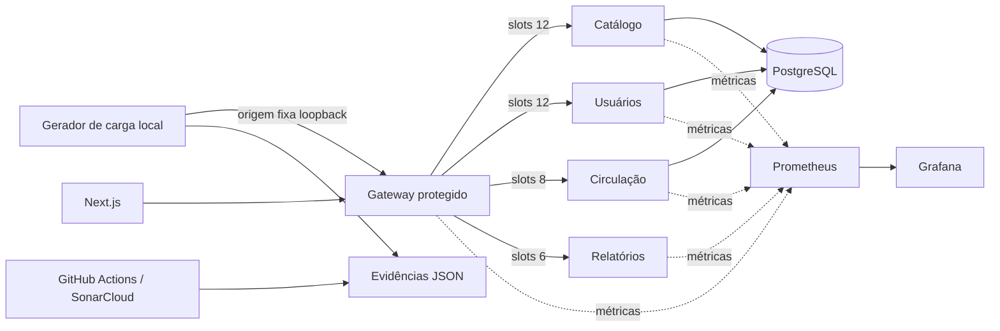

# SDD-001.1 — INKO Gateway Hardening & Capacity Validation

| Campo | Valor |
|---|---|
| Versão | 1.0 — proposta para implementação |
| Data | 13/11/2026 |
| Projeto | INKO — Gestão de Biblioteca de Mangás e HQs |
| Predecessor | [SDD-001 — Gateway Resilience & Capacity](https://github.com/DevAngeloOliveira/Inko/blob/8feaef90b6c348c5a387d8f30c9199039a864cd0/docs/architecture/SDD-001-gateway-resilience-capacity.md) |
| Baseline | `8feaef90b6c348c5a387d8f30c9199039a864cd0` (main e dev/angelo na consulta) |
| Implementação | `dev/angelo` exclusivamente |
| Entrega | PR `dev/angelo` → `main`, com merge condicionado aos gates |
| Destino sugerido | `docs/architecture/SDD-001.1-gateway-hardening-capacity-validation.md` |
| Estado | Não implementado; critérios ainda não validados nesta revisão |

## 1. Resumo executivo

O SDD-001 introduziu limites explícitos de admissão, pools independentes, rate limiting, deadline absoluto, circuit breaker, snapshot de saúde e métricas. A implementação já está integrada à main pelo PR #11. O SDD-001.1 é um incremento de correção e aceite: não substitui a arquitetura, não amplia o domínio funcional e não adiciona infraestrutura paga.

Há três bloqueadores técnicos: (1) o Quality Gate agora é calculado, porém Security e Reliability estão C; (2) os ensaios Linux sob 1 vCPU/512 MiB não comprovam as metas de latência e sucesso; (3) o scrape Java retornou 404 em imagens locais reutilizadas, impedindo a observação de recursos downstream. A sincronização de branches, anteriormente pendente, está resolvida na baseline consultada. O aceite exige evidência do SHA realmente integrado, não somente um PR verde.

Resultado esperado: manter as invariantes de capacidade do SDD-001, corrigir issues reais, tornar o benchmark confiável e verificar a instrumentação dos serviços. O SDD-002 poderá então modelar as regras e os limites dos domínios sem depender de premissas de desempenho não verificadas.

## 2. Diagnóstico rastreável

### 2.1 Estado remoto

- [Commit de integração](https://github.com/DevAngeloOliveira/Inko/commit/8feaef90b6c348c5a387d8f30c9199039a864cd0) e [PR #11](https://github.com/DevAngeloOliveira/Inko/pull/11): Gateway modular, testes HTTP/TCP, SDD e ADR-003, perfil Compose de capacidade e dashboard.
- [CI da main](https://github.com/DevAngeloOliveira/Inko/actions/runs/43396617221): jobs Gateway, Java, Web e Compose concluídos com sucesso. Publicação GHCR ignorada por não ser release.
- [Auditoria da main](https://github.com/DevAngeloOliveira/Inko/actions/runs/43396617220): expectedSha = analyzedSha = baseline; analysisId `baecbfdb-2267-4705-8f95-78fa7b4951ec`; gate `ERROR`; security_rating = 3.0, reliability_rating = 3.0, sqale_rating = 1.0. Condições `new_security_rating` e `new_reliability_rating` com valor 3, limite 1. Há 52 issues abertas coletadas sem truncamento, duas de segurança; duplicação de código novo 0,4%, hotspots revisados 100%.
- [SonarCloud da main](https://sonarcloud.io/dashboard?id=DevAngeloOliveira_Inko&branch=main): o gate nativo reprova, não retorna mais `NONE`. Não alterar New Code Definition para esconder issues.
- `dev/angelo` e `main` apontavam para o mesmo SHA na consulta de 13/11. Revalidar antes de alterar código; não presumir que permanecerão sincronizadas.

### 2.2 Issues confirmadas

| ID Sonar | Arquivo/linha na baseline | Regra | Impacto |
|---|---|---|---|
| `AaHUHE-dIPqd_ggUi3z4` | `scripts/ops/measure-gateway.py:64` | `pythonsecurity:S8703` | SECURITY / MEDIUM |
| `AaHUHE-dIPqd_ggUi3z5` | `scripts/ops/measure-gateway.py:65` | `pythonsecurity:S8703` | SECURITY / MEDIUM |

A regra descreve SSRF por argumentos CLI. O script valida `args.url` para HTTP e hostname literal 127.0.0.1 ou ::1 antes de `measure(args)`, mas os dois `httpx.AsyncClient` usam o texto original como `base_url`. Não há prova de exploração na configuração existente; a correção deve eliminar a passagem de URL arbitrária ao transporte, preservando o uso local. Nenhum alerta é suprimido.

**Reliability:** a auditoria atual lista apenas `securityIssues`; a quantidade, as regras e as linhas de Reliability não foram obtidas nesta revisão. O status C é confirmado. Não atribuir as falhas ao middleware ou ao frontend sem o inventário. A API pública do SonarCloud não pôde ser consultada diretamente nesta sessão; usar o fluxo de auditoria já existente ou exportar as issues no painel antes de editar.

### 2.3 Evidências de capacidade

Fonte: [GATEWAY-CAPACITY-EVIDENCE.md](https://github.com/DevAngeloOliveira/Inko/blob/8feaef90b6c348c5a387d8f30c9199039a864cd0/docs/devops/GATEWAY-CAPACITY-EVIDENCE.md), resultados registrados em 12/11/2026. Não são medições realizadas nesta revisão.

| Cenário Linux (repetição) | Programadas / enviadas / descartadas | Respostas | p95 / p99 máximos |
|---|---|---|---|
| Normal, 10 req/s, 120 s | 1200 / 1143 / 57 | 1070 × 200, 51 × 429, 13 × 504, 9 falhas de rede | 1751 / 3599 ms |
| Saturação, 120 req/s, 30 s | 3600 / 2577 / 1023 | 653 × 200, 1445 × 429, 475 × 503 Uvicorn, 4 × 503 app | 3177 / 3741 ms |
| Isolamento, 12 req/s, 30 s | 360 / 360 / 0 | Relatórios 290 × 503, 10 × 504; Circulação 60 × 200 | Circulação 1068 / 1408 ms |

Na primeira rodada de soak, 600 s: 6000 programadas, 5844 enviadas, 156 descartadas, 5743 respostas 200, pico cgroup 58,8 MiB, após pausa 54,5 MiB; RSS 64,8 MiB após pausa. Houve lag do agendador de até 6,01 s e concorrência com builds. O ensaio Windows sem limite equivalente teve 1191/1191 respostas 200 e p95/p99 máximos 9/254 ms. Não comparar os ambientes como se tivessem os mesmos recursos.

As invariantes de concorrência e zero fan-out no status têm evidências de testes; o smoke local final passou. A primeira saturação registrou um 500; a repetição após ajuste registrou zero. Isso não comprova ausência de regressões em todos os cenários. O gerador descarta chegadas atrasadas ou quando pending chega a 128; seus percentis atuais excluem erros de rede e não incluem atraso entre chegada programada e dispatch. A pressão efetiva pode ser menor que a declarada. As metas de carga normal continuam pendentes.

### 2.4 Observabilidade downstream

Os POMs/configurações da baseline incluem Actuator, Micrometer Prometheus e exposição `health,info,prometheus`. As evidências locais relatam 404 nos quatro endpoints `/actuator/prometheus` em imagens reutilizadas, não um diagnóstico de causa. O PostgreSQL relatou max_connections=100 e dez sessões por banco de aplicação durante coleta; não é prova de capacidade com SQL real. Relatórios não tem datasource próprio. Investigar imagens, classpath e auto-configuração antes de trocar dependências ou aumentar pools.

## 3. Escopo, não objetivos e invariantes

**Incluído:** corrigir Security/Reliability, reforçar contratos de transporte e recuperação onde houver defeito comprovado, tornar auditoria rastreável ao SHA, verificar métricas Java, corrigir instrumentação e metodologia de carga, rodar regressões, atualizar runbook/evidências e fechar aceite.

**Excluído:** deploy remoto, Kubernetes, Redis, Kafka, serviço novo, autenticação de domínio, operações reais de empréstimo/devolução, mensageria, reescrita geral, escalabilidade horizontal e otimizações especulativas. Não alterar as telas ou o Design System sem necessidade de correção identificada. Não publicar nova release apenas para validar; não reescrever histórico ou alterar a v0.4.0 publicada.

| Invariante preservada | Valor atual |
|---|---|
| Worker / guarda Uvicorn / backlog | 1 / 64 / 128 |
| Slots negócio | 38 = Catálogo 12 + Usuários 12 + Circulação 8 + Relatórios 6 |
| Slots controle / conexões exclusivas de sondagem | 6 / 4 |
| Fila de admissão de negócio | 0; rejeição imediata |
| Quota global / por peer | 60/s burst 32 / 30/s burst 16 |
| Buckets de peer | 1024, TTL 120 s, overflow 5/s burst 5 |
| Deadline / reserva de resposta | 2 s / 50 ms |
| Limites de request / response | 64 KiB / 1 MiB |
| Tentativas negócio / retries | ≤1 por admitida / 0 |
| Sondas / status | até 4 a cada 5 s; zero sondas por leitura; stale >15 s |
| Circuit breaker | 5 falhas elegíveis; cooldown 10 s; 1 half-open; geração protege resultados antigos |
| Recursos de referência | 1 vCPU / 512 MiB no Gateway |

Guarda Uvicorn, quota global, CPU, memória e conexão de entrada são compartilhadas. Bulkhead garante isolamento de slots/pools por destino, não isolamento absoluto de CPU ou disponibilidade de controle sob saturação global. Cancelar uma chamada HTTP não garante cancelar processamento downstream. Nenhum aumento de worker, limite ou deadline é permitido para maquiar um benchmark. Mudança de capacidade exige medição comparável, justificativa/ADR e regressões.

## 4. Arquitetura corretiva



A topologia dos sete containers não muda. Prometheus/Grafana continuam opcionais no ambiente local e sem exposição pública. O gerador de carga é uma ferramenta operacional, não parte do runtime do Gateway. O novo contrato de medição não deve afetar o budget de negócio. Instrumentação de diagnóstico deve ter cardinalidade limitada e não consumir recursos ilimitados.

## 5. Frente Q — Qualidade, segurança e auditoria

### Q1 — Eliminar o fluxo de URL arbitrária no benchmark (P0)

Arquivo-alvo: `scripts/ops/measure-gateway.py`. Proposta preferida: substituir `--url` por `--port` (int, default 8000, 1–65535) e `--family {ipv4,ipv6}` (default ipv4). Montar a origem exclusivamente de literal `http://127.0.0.1` ou `http://[::1]` e porta validada. Não aceitar host, credenciais, caminho, query, fragmento, proxy, redirecionamento ou scheme configurável. Preservar `--source`, `--seconds`, `--cooldown`, modos de cenário. Se compatibilidade com `--url` for necessária, aceitar somente sintaxe canônica exata, extrair família/porta e descartar texto original; não repassar URL de entrada ao transporte. Documentar a decisão e atualizar chamadas existentes. Não usar `NOSONAR`.

Exemplo de contrato (pseudocódigo de especificação, não patch):

```python
from dataclasses import dataclass
from enum import Enum

class AddressFamily(Enum):
    IPV4 = "ipv4"
    IPV6 = "ipv6"

@dataclass(frozen=True, slots=True)
class LocalTarget:
    family: AddressFamily
    port: int

    def __post_init__(self):
        if not isinstance(self.family, AddressFamily) or type(self.port) is not int or not 1 <= self.port <= 65535:
            raise ValueError("Invalid local target")

    @property
    def origin(self) -> str:
        host = "127.0.0.1" if self.family is AddressFamily.IPV4 else "[::1]"
        return f"http://{host}:{self.port}"
```

Ambos os clientes HTTPX recebem `LocalTarget.origin`, `trust_env=False`, `follow_redirects=False`; método GET e caminhos fixos por allowlist de serviços. Não registrar segredo no JSON. O modo stub continua local por padrão; `0.0.0.0` só para rede Docker descartável explícita, sem portas expostas. Validar a porta inicial para quatro listeners. Não transformar a ferramenta em proxy ou scanner. Se o Sonar continuar marcando o fluxo, revisar a regra e seu dataflow; não declarar resolvido até a análise remota confirmar.

Testes: portas 0/65536/texto; hosts externos, metadata IP, userinfo, esquemas alternativos, IPv4-mapped, caracteres de controle, redirects, proxy do ambiente e inputs malformados; confirmar zero dispatch para argumentos inválidos e que ambos os clientes usam exclusivamente loopback. Teste positivo em 127.0.0.1 e IPv6 loopback quando suportado pelo runner. Teste de regressão com stub local e cenário curto. Atualizar o runbook para `--port "$GATEWAY_PORT"` e testes correspondentes.

### Q2 — Inventário Reliability e remediação verificável (P0)

Antes de alterações, ampliar `scripts/ci/sonar-main-audit.py` para inventariar issues por qualidade (`SECURITY`, `RELIABILITY`, `MAINTAINABILITY`), incluindo tipo legado `BUG` quando aplicável, regra, chave, arquivo, intervalo, mensagem, severidade/impactos e status. Manter compatibilidade com `securityIssues` e acrescentar `reliabilityIssues`. Consultar a branch ou PR exato; deduplicar por chave, paginar e falhar se resposta inválida/truncada. Produzir JSON e summary sem tokens; escapar conteúdo não confiável em Markdown e evitar logs de secrets. Para as 52 issues, classificar escopo: todas as abertas de Reliability (overall) e de segurança devem ser resolvidas para A; maintainability não bloqueante pode ser tratada depois, desde que o gate e demais condições permaneçam verdes.

Fluxo por issue: reproduzir com teste ou evidência → identificar causa → patch mínimo → teste de regressão → análise Sonar → registrar chave resolvida. Não deduzir que todos os bugs estão no Gateway: o projeto inclui Web, scripts e Java. Não alterar critérios do gate, exclusões ou marcar false positive para cumprir meta. Se uma regra estiver tecnicamente incorreta, documentar e solicitar decisão explícita, mantendo o aceite pendente até resolução.

Casos de investigação não atribuídos ao Sonar: (a) corrida de deadlines e envio ASGI já tratada nos testes; reforçar se reproduzível; (b) path/URI e Content-Length malformados; (c) cleanup do stub em inicialização parcial; (d) portabilidade do teste de tokens no Windows relatada nas evidências. Cada item recebe teste antes de mudança; não afirmar que corresponde à issue Reliability sem inventário.

### Q3 — Gate por revisão exata (P0)

Preservar `wait_for_gate` e análise vinculada a SHA já implementados: consultar `project_analyses/search` e `qualitygates/project_status` por analysisId, esperar bounded até 600 s, verificar análise antes e depois de métricas/issues; falhar se revisão mudar, API indisponível, `NONE`, `WARN`, `ERROR`, inventário incompleto ou SHA divergente. Acrescentar exigência explícita `overallReliabilityRating == A`, `overallSecurityRating == A` e condições do gate `OK`. O workflow já executa modo estrito para a main; não duplicar scanner nem usar segredos em PRs. No PR, validar check nativo para head atual e registrar diagnóstico do PR sem confiar em análise de commit anterior. Não exigir overall main A como check de PR enquanto o próprio PR corrige a main; o check de PR avalia o código novo e o pós-merge comprova a base.

Testes sintéticos: revisão desatualizada, gate ERROR/NONE/WARN, security C, reliability C, resposta truncada, análise que muda durante leitura, 401/403, expiração do prazo, sucesso com SHA correto e A/A. Reexecutar a auditoria somente se necessário; nenhuma aprovação por ausência de dados. Atualizar `docs/devops/SONARCLOUD-BASELINE.md`.

## 6. Frente R — Robustez de transporte e isolamento

Manter os módulos `config.py`, `http.py`, `resilience.py`, `upstream.py`, `main.py` e `telemetry.py` como limites de responsabilidade. A implementação presente atende ao desenho; não reescrever por estilo. Usar testes determinísticos e testes reais HTTP/TCP para detectar regressões.

1. **Deadline e cancelamento:** preservar `asyncio.timeout_at` com deadline original; classificar 408 (recebimento), 504 (upstream), 503 (envio antes dos headers). Após headers não escrever segunda resposta; abortar transporte de forma controlada. Deadline não é garantia de wall-clock se o event loop/host não for agendado. Testar expiração simultânea, send bloqueado, disconnect e shutdown; lease deve ser liberado exatamente uma vez.
2. **Capacidade:** manter admissão sem fila e pools por destino. Testar concorrência com barreiras/quotas independentes: 13 Catálogo, todos os destinos até 38, controle até 6, Relatórios 6 enquanto Circulação pode ocupar 8. Verificar contadores de leases e tarefas no fim. Guard Uvicorn 503 pode anteceder envelope da app; documentar e medir separado, não remover a proteção.
3. **Quota e breaker:** relógio monotônico, TTL/limite de buckets, overflow fixo, geração do breaker, half-open exclusivo. Diferenciar cancelamento neutro, pool timeout, 429 upstream, 5xx e falhas de transporte. Testar que rejeições não despacham upstream. Rate por peer TCP pode compartilhar bucket no Next.js; não confiar em X-Forwarded-For sem fronteira confiável. Quota por usuário autenticado é evolução futura, não neste SDD.
4. **Limites e confiança:** conservar rotas explícitas, método GET e pings sem corpo/query, rejeitar headers/caminho inválidos e encoding não suportado, limite efetivo de bytes no stream, redirects desativados. Verificar configuração da camada h11 e proteção antes do middleware: bytes/parsers e conexões ociosas não são cobertos integralmente pelo deadline ASGI; se o ensaio de slow-client demonstrar risco, definir teto do parser e timeout de headers em camada local de entrada com teste, sem publicar portas. Não prometer proteção absoluta contra toda forma de DoS.
5. **Snapshot e métricas:** manter ciclo único, sem overlap, sem retry e sem dependência da quantidade de leituras. Testar atraso de scheduler, snapshot stale, falha de um destino e encerramento de probes. Não abrir circuit breaker de negócio por falhas da sonda sem nova decisão arquitetural.

## 7. Frente O — Observabilidade Java e Gateway

### O1 — Diagnóstico dos quatro endpoints Java (P1)

Executar em projeto Compose isolado, com rebuild dos quatro serviços a partir do SHA de teste e sem reuso de containers de outro projeto. Registrar image ID, labels/revisão e JAR correspondente. Consultar internamente `/actuator/health`, `/actuator` e `/actuator/prometheus` (não publicar portas). Confirmar content type e corpo Prometheus, presença de métricas JVM/processo e métricas HTTP após chamadas. Se 404 persistir: conferir `mvn dependency:tree`, classes do registry dentro do JAR, configuração efetiva do management endpoint, perfis/env e auto-configuração Spring Boot 4.1.2. Verificar módulos/starter exigidos pela versão antes de alterar POM; não adicionar dependências especulativas. Verificar logs e causas, corrigir minimamente e repetir.

Nos três serviços JDBC, verificar séries Hikari (ativas/ociosas/pendentes/máximo) após inicialização do datasource; usar somente nomes realmente expostos. Relatórios não deve ganhar JDBC só por métricas. O smoke precisa validar os quatro endpoints internos e o scrape `up{job="inko-java"} == 1` quando overlay estiver ativo. Confirmar `up{job="inko-gateway"} == 1` e regras Prometheus válidas. Não expor actuator ou métricas pela Web/Caddy; manter endpoints técnicos no loopback/rede interna. Atualizar o dashboard existente e runbook, sem criar um novo stack de monitoramento.

### O2 — Métricas e orçamento downstream (P1)

| Observação | Evidência exigida |
|---|---|
| Gateway | in-flight por plano/destino, admissions, attempts, rejeições por causa, pool timeouts, breaker, snapshot age, lag, RSS/cgroup |
| Java | HTTP request latency/count, threads ocupadas e limite quando expostos, JVM heap/GC/CPU, pool Hikari nos três JDBC |
| PostgreSQL | max_connections, sessões por banco, sessões ativas/ociosas, reserva para admin e manutenção; consulta SQL em ambiente local |

Acompanhar Tomcat/Hikari sem inventar capacidade. Fixar envelope de conexões por perfil quando houver evidência: soma de `replicas × maximumPoolSize` dos três serviços JDBC + reserva operacional deve caber no orçamento utilizável do PostgreSQL, descontando conexões reservadas e outros consumidores. Não presumir 100 conexões integralmente disponíveis. Não aumentar pools para compensar latência; pings não exercitam SQL de domínio. O SDD-002 validará dimensionamento real com consultas, índices e transações. Sem exporter adicional obrigatório; consultas SQL controladas bastam nesta fase.

## 8. Frente P — Metodologia de capacidade reproduzível

### P1 — Corrigir o instrumento de medição (P1)

O benchmark deve ser tratado como software testado. Preservar chegada aberta e limites de pending/conexões. Não esconder atraso do gerador nem comparar percentis de amostras diferentes.

- Medir por requisição `scheduled_at`, `task_started_at`, `completed_at` com relógio monotônico. Registrar atraso de chegada/dispatch e latência cliente observada (inclui espera do pool HTTPX); se instrumentar wire, reportar separadamente. Reportar p95/p99 fim a fim desde chegada programada, e p95/p99 da latência cliente por status e destino. Não confundir latência de sucesso com latência de rejeição. Network errors e timeout do cliente devem ter duração registrada e contagem explícita, sem convertê-los em 200. Chegadas não enviadas não possuem latência observada; contar como falhas de entrega da carga.
- Contabilizar `scheduled = sent + dropped`, `sent = sum(outcomes)`, por cenário e destino; descrever cada descarte (lag >100 ms ou pending cap), timeout de pool do gerador, erro de rede e status HTTP. Separar 503 app por problem code do 503 do Uvicorn, e 504/408. Validar essas identidades em teste e ao gerar relatório. Nunca excluir descartes da taxa de sucesso sobre chegadas programadas.
- Gerador: limites explícitos e registrados (atualmente 64 conexões, 32 keepalive, pending 128, timeout 4 s). Registrar lag do gerador, pico pending e pool timeouts. Cap de 128 evita fila infinita, mas descarte alto invalida a carga declarada. Ajustar o gerador ou usar peer(s) controlados sem aumentar capacidade do Gateway para validar hipótese. Não usar proxies externos.
- Métricas: coletar séries com labels completas; preferir parser compatível com formato Prometheus ou parser testado para o subconjunto; tratar falhas de scrape, counters com reset, ausência de série e amostras fora do intervalo. Capturar `before/peak/after`, diferenças de counters e picos de gauges. Registrar scrape coverage e taxa de falha. A soma das tentativas de negócio deve ser ≤ admissões na janela fechada (sem requests anteriores pendentes); controle separado. A amostragem de 1 s pode perder picos: provas dos tetos vêm dos testes de barreira/invariantes, não só da amostragem.
- Proteger o próprio benchmark: validar parâmetros finitos e limites positivos; teto de duração e quantidade de chegadas por execução, configurado/documentado (proposta 1800 s, 100 mil chegadas), retenção de amostras limitada e sem payloads pessoais. Testar cancelamento, falha de scrape e startup/teardown do stub; no caso de erro parcial, fechar todos os listeners abertos. Versionar schema de JSON, parâmetros, seed quando aplicável e commit/image IDs.

### P2 — Bancada e protocolo (P1)

Usar `compose.capacity.yaml` (1 vCPU e 512 MiB) com stack isolada e portas de loopback alternativas. Antes da coleta: terminar builds, aguardar health, snapshot fresco e métricas estáveis, aquecer 30 s sem incluir warmup nos resultados, zerar janelas por delta (não resetar contadores do runtime), registrar recursos do host/VM, Docker, CPU/memória do container, versão Python, SHA e IDs de imagens, configuração efetiva, workload e limites. Coletar CPU throttling, RSS/cgroup, lag do host/gerador e event loop, conexões/scrapes. Sem cargas concorrentes intencionais; registrar contenção observada. Não apagar volumes do usuário; usar `docker compose -p <projeto-isolado> down` sem `-v` fora de CI descartável. Não usar `docker system prune`.

Executar três rodadas válidas independentes de normal, saturação e isolamento; cooldown entre elas ≥12 s e até zerar in-flight e recuperar circuitos. Executar ao menos um soak de 600 s após calibração. Usar o mesmo envelope e perfil de stubs para comparação baseline/candidato. Rodada com descarte >1% por problema do gerador, perda relevante de métricas (proposta cobertura <95%), reinício, imagem incorreta ou build concorrente é inválida para aceite; arquivar, diagnosticar e repetir, sem ocultar dados. Se o gargalo estiver no alvo e não no gerador, classificá-lo como falha do cenário, não invalidar seletivamente. Se não houver ambiente estável, registrar PARTIAL, não declarar SLO cumprido.

Dois modos: (A) stubs HTTP controlados para atribuir atraso ao Gateway e testar falhas; (B) stack real de sete containers para smoke, observação Java/PG e carga de pings normal. Metas de performance referem-se ao perfil A e devem ser reportadas separadamente no perfil B; pings não são benchmark de operações de biblioteca. Não rodar teste pesado em cada PR; CI exige regressões determinísticas e smoke; benchmark completo manual/local, repetível antes do merge ou em runner dedicado quando houver recursos disponíveis.

### P3 — Matriz de cargas e metas

| Cenário | Carga programada | Aceite proposto |
|---|---|---|
| Normal | 10 req/s × 120 s; quatro destinos | p95 ≤500 ms, p99 ≤1500 ms fim a fim, ≥99% 200 sobre programadas, zero 5xx inesperados, medir cada destino |
| Saturação | 120 req/s × 30 s | 429/503 esperados, 504 apenas se justificável por falha upstream injetada; zero 500, sem OOM/restart; teto de slots preservado; rejections sem fila ilimitada; retorno a zero após cooldown |
| Isolamento | 12 req/s × 30 s; 10/s Relatórios com 1,5 s, 2/s Circulação | Relatórios ≤6 em voo; Circulação ≥99% 200 sobre programadas, p95 ≤baseline saudável +100 ms em bancada controlada; saturação global testada à parte |
| Soak | 10 req/s × 600 s | metas normal; sem OOM/restart; in-flight retorna a zero, sem tendência persistente de RSS/cgroup ou buckets/tarefas |
| Falha/recuperação | 5 falhas elegíveis + cooldown | abre circuito, zero chamadas durante open, apenas 1 half-open, fecha com sucesso; resultado de geração anterior ignorado |
| Status storm | 100 acessos em lotes | 0 probes adicionais; até 4 por ciclo programado; snapshot consistente; 503 permitido sob guarda global |

As metas de normal/isolamento vêm do SDD-001; descarte ≤1%, cobertura ≥95%, três repetições e critérios adicionais são propostas deste incremento. Para soak, registrar RSS pós-warmup, janelas e após cooldown; proposta de alerta de regressão: crescimento pós-cooldown >20 MiB e >25% da baseline comparável exige investigação (não prova isoladamente leak). Também exigir teste de número de tarefas/leases e ausência de crescimento monotônico em janelas. Se alteração de meta for necessária por hardware, justificar antes da nova rodada e manter números originais para comparação; não relaxar após falha para obter verde.

## 9. Plano de execução em dev/angelo

Sem worktrees com branches adicionais, sem push forçado e sem commits automáticos do bot. Antes de começar, `git status`, `git fetch origin`, verificar SHA e ancestralidade; se dev estiver atrás e sem divergência, `git merge --ff-only origin/main` em dev; se houver commits exclusivos, reconciliar por merge explícito e preservar o trabalho. Não executar reset destrutivo. Confirmar arquivo do SDD no diretório proposto e criar commits semânticos em inglês, sem trailers de coautoria automáticos.

| Incremento | Entrega | Commit sugerido | Dependência |
|---|---|---|---|
| C0 | Registrar SDD e inventário de qualidade | `docs(architecture): specify gateway hardening acceptance` | baseline |
| C1 | Corrigir duas S8703 e testar CLI | `fix(security): constrain gateway benchmark to loopback origins` | C0 |
| C2 | Inventário Reliability, correções por causa, auditoria estrita A/A | `fix(quality): remediate Sonar findings and verify revision ratings` | C0, C1 |
| C3 | Regressões HTTP/TCP e contratos; patches apenas de falhas demonstradas | `test(gateway): harden deadline and capacity regression coverage` | C1, C2 |
| C4 | Diagnóstico e correção de scrape Java e smoke | `fix(observability): verify Java actuator metrics in Compose` | C2 |
| C5 | Instrumento de carga, schemas, testes e protocolo | `test(performance): account for scheduled arrivals and benchmark resources` | C1, C3 |
| C6 | Ensaios, relatório comparável e runbook | `docs(devops): record reproducible gateway capacity validation` | C3–C5 |

Commits de correção específicos por regra/causa são preferíveis a um commit grande; os nomes acima são sugestões. Não implementar funcionalidade de domínio neste incremento. Se uma causa de Reliability envolver módulo não relacionado, isolar a mudança e justificar o alcance. Validar local e PR a cada unidade lógica.

## 10. Matriz de critérios de aceite

Os AC-01 a AC-20 do SDD-001 permanecem válidos. A seguir estão os critérios adicionais do incremento corretivo.

| ID | Critério verificável | Evidência |
|---|---|---|
| HC-01 | Ambos os clientes do gerador usam origem loopback canônica; inputs inválidos não iniciam HTTP | testes CLI/transport |
| HC-02 | As duas chaves S8703 não estão abertas após análise do SHA corrigido | SonarCloud |
| HC-03 | Inventário completo Reliability e remediação por regra/chave, sem suppressions | JSON/PR |
| HC-04 | PR com Quality Gate OK, new Security A e new Reliability A; demais condições preservadas | check do head atual |
| HC-05 | Main com Quality Gate OK, overall Security A e overall Reliability A; SHA exato, analysisId registrado | auditoria estrita |
| HC-06 | Auditoria falha com SHA divergente, análise stale, dados truncados, gate indisponível ou rating não A | testes sintéticos |
| HC-07 | Todas as regressões do SDD-001 aprovadas; slots e pools respeitam 38/12/12/8/6, controle 6; zero retries | pytest HTTP/TCP e barreiras |
| HC-08 | Erro de prazo antes dos headers sem segunda resposta; após headers aborta; disconnect/cleanup liberam recursos | testes ASGI/TCP |
| HC-09 | Status não despacha chamadas extras, probes independentes, breaker preserva geração/half-open | pytest |
| HC-10 | Quatro imagens Java reconstruídas e `/actuator/prometheus` retorna 200 interno com métricas | smoke + image IDs |
| HC-11 | Prometheus targets Java/Gateway UP, regras válidas; métricas não expostas pela Web | scrape/HTTP/promtool |
| HC-12 | JSON contabiliza chegadas, descartes, resultados, latências por classe e erros de rede | testes do gerador |
| HC-13 | Três rodadas válidas de normal no perfil 1 vCPU/512 MiB atendem metas originais | relatório JSON + ambiente |
| HC-14 | Saturação e isolamento demonstram rejeição controlada e proteção de slots sem 500 inesperado | três rodadas por cenário |
| HC-15 | Soak com retorno de in-flight a zero, sem OOM/restart ou crescimento persistente não explicado | relatório de memória/tarefas |
| HC-16 | Benchmarks inválidos preservados, descarte/lag explicado, metas não alteradas retroativamente | relatório comparativo |
| HC-17 | Smoke dos sete containers, três bancos, Web e quatro pings; sem perda de dados | GitHub Actions/Compose |
| HC-18 | dev/angelo → main com revisão e checks; main e dev sincronizadas após merge | refs + PR |
| HC-19 | Runbook, ADR se alterado, evidências e limitações documentados | diff docs |
| HC-20 | Nenhum deploy, nova infraestrutura paga, alteração de release existente, novo domínio funcional ou mudança não aprovada de envelope | revisão do diff |

## 11. Gates, rollback e Definition of Done

**Pré-merge:** confirmar a baseline e o inventário; executar testes Gateway com `uv sync --locked --extra test --no-build --no-install-project` e `.venv/bin/python -m pytest -q` (ou caminho Windows equivalente); testes da auditoria, scripts de benchmark e smoke; Maven test nos quatro serviços; Web typecheck/test/build e tokens; validação Compose e Prometheus; Trivy, SonarCloud e CI. Fazer benchmark local completo com evidências e comparar. O fluxo de integração atual usa paths filters: confirmar que os caminhos novos de scripts de carga/testes acionam a validação necessária; incluir paths no workflow se pertinente, sem disparar benchmarks longos em toda alteração de docs. Dependências novas só com lockfile/justificativa. Nenhuma exclusão ou relaxamento de regra.

**Pós-merge:** conferir SHA integrado na main, análise Sonar exata, Quality Gate OK e A/A gerais, CI concluída, relatório de smoke/benchmarks vinculado ao código testado; se o merge incluir diferença de código/config que afete desempenho, repetir os ensaios relevantes. Sincronizar dev/angelo por fast-forward se possível. O PR verde não é prova do Quality Gate geral da main. Se algum gate falhar depois do merge, registrar incidente, bloquear release/avanço para o SDD-002 e corrigir via dev/angelo; não sobrescrever main. Revert somente por PR controlado caso haja regressão comprovada e preservando histórico e dados. O perfil anterior pode ser executado por checkout separado ou imagem conhecida localmente; sem `down -v` em volumes reais.

**Estados:** `IMPLEMENTED` = alterações integradas, ainda sem aceite; `PARTIAL` = código/testes aprovados com algum ensaio ou qualidade pendente; `ACCEPTED` = HC-01–20 e critérios anteriores aplicáveis comprovados, gate main OK A/A no SHA integrado. Não marcar ACCEPTED com métricas ausentes ou baseline inadequada. A ausência de infra externa não é bloqueador: o sistema é acadêmico e o aceite é local/CI. Nenhuma publicação de packages nova é necessária para esta etapa.

## 12. Arquivos impactados e entregáveis

- `scripts/ops/measure-gateway.py` e testes associados: target local, contabilidade, schema e cleanup.
- `scripts/ci/sonar-main-audit.py`, `scripts/ci/test_sonar_main_audit.py`, `.github/workflows/sonar-main-audit.yaml`: inventário de qualidade e gate por revisão.
- `apps/gateway/inko_gateway/{config,http,main,resilience,upstream,telemetry}.py` e `apps/gateway/tests/`: apenas correções demonstradas e regressões.
- `services/*/pom.xml`, `services/*/src/main/resources/application.yaml`, `infra/docker/java-service.Dockerfile`: investigação; alterar somente após diagnosticar causa do 404.
- `infra/observability/prometheus/*`, dashboard Grafana, `scripts/ci/smoke-compose.sh`, `.github/workflows/integration.yaml`: verificação de scrape e gatilhos pertinentes.
- `docs/devops/GATEWAY-CAPACITY.md`, `GATEWAY-CAPACITY-EVIDENCE.md`, `SONARCLOUD-BASELINE.md`, `docs/architecture/ADR-003-gateway-capacity.md` (somente se decisão mudar): runbook e evidências atualizados. Preservar relatório histórico, anexar rodadas novas com data e SHA, nunca substituir medições antigas por números inventados.

Relatório final deve conter: SHA/PR, inventário antes/depois, regras corrigidas, testes executados e resultados, versões e imagem de cada componente, ambientes e limites, JSON dos cenários e comparação com metas, desvios e bloqueadores, estado final. Artefatos grandes de carga podem ficar fora do Git com resumo versionado e referência a artifacts de CI quando disponíveis; não incluir dados sensíveis.

## 13. Decisões e trade-offs

- **Correção incremental versus reescrita:** preservar arquitetura comprovada; menor risco e maior rastreabilidade.
- **LocalTarget versus URL CLI:** perde flexibilidade de apontar a hosts externos, ganha fronteira de confiança coerente com ambiente acadêmico. Não há requisito de benchmark remoto.
- **Carga aberta versus fechada:** chegada aberta revela saturação, exige medir descartes/lag. Teste fechado isolado não prova capacidade em RPS programados.
- **Um worker versus escalabilidade horizontal:** manter orçamento verificável por processo; réplicas requerem multiplicação dos limites, orçamento downstream e rate limiting distribuído, fora do escopo.
- **CI rápido versus benchmark prolongado:** invariantes determinísticas bloqueiam PR; medições prolongadas em bancada controlada evitam gastos e falsos alarmes em runners compartilhados.
- **Quality Gate versus aprovação superficial:** gate por SHA e ratings gerais impedem falsos verdes; não alterar SonarCloud para reduzir exigência.

## 14. Referências e limitações

Fontes de verdade: [SDD-001](https://github.com/DevAngeloOliveira/Inko/blob/8feaef90b6c348c5a387d8f30c9199039a864cd0/docs/architecture/SDD-001-gateway-resilience-capacity.md), [ADR-003](https://github.com/DevAngeloOliveira/Inko/blob/8feaef90b6c348c5a387d8f30c9199039a864cd0/docs/architecture/ADR-003-gateway-capacity.md), [runbook](https://github.com/DevAngeloOliveira/Inko/blob/8feaef90b6c348c5a387d8f30c9199039a864cd0/docs/devops/GATEWAY-CAPACITY.md), [evidências](https://github.com/DevAngeloOliveira/Inko/blob/8feaef90b6c348c5a387d8f30c9199039a864cd0/docs/devops/GATEWAY-CAPACITY-EVIDENCE.md), [script de medição](https://github.com/DevAngeloOliveira/Inko/blob/8feaef90b6c348c5a387d8f30c9199039a864cd0/scripts/ops/measure-gateway.py), [auditoria Sonar](https://github.com/DevAngeloOliveira/Inko/actions/runs/43396617220), [CI](https://github.com/DevAngeloOliveira/Inko/actions/runs/43396617221).

Limitações desta especificação: não foram executados testes novos, rebuilds Java, benchmark ou alterações no GitHub. O inventário detalhado de Reliability está pendente e a causa dos 404 não foi determinada. Os números de aceitação adicionais são decisões propostas, não medições. O relatório existente é de bancada com pings/stubs, não de produção nem de domínio completo. O SDD não afirma que a arquitetura é ilimitadamente escalável; estabelece como provar sua capacidade no envelope atual.
